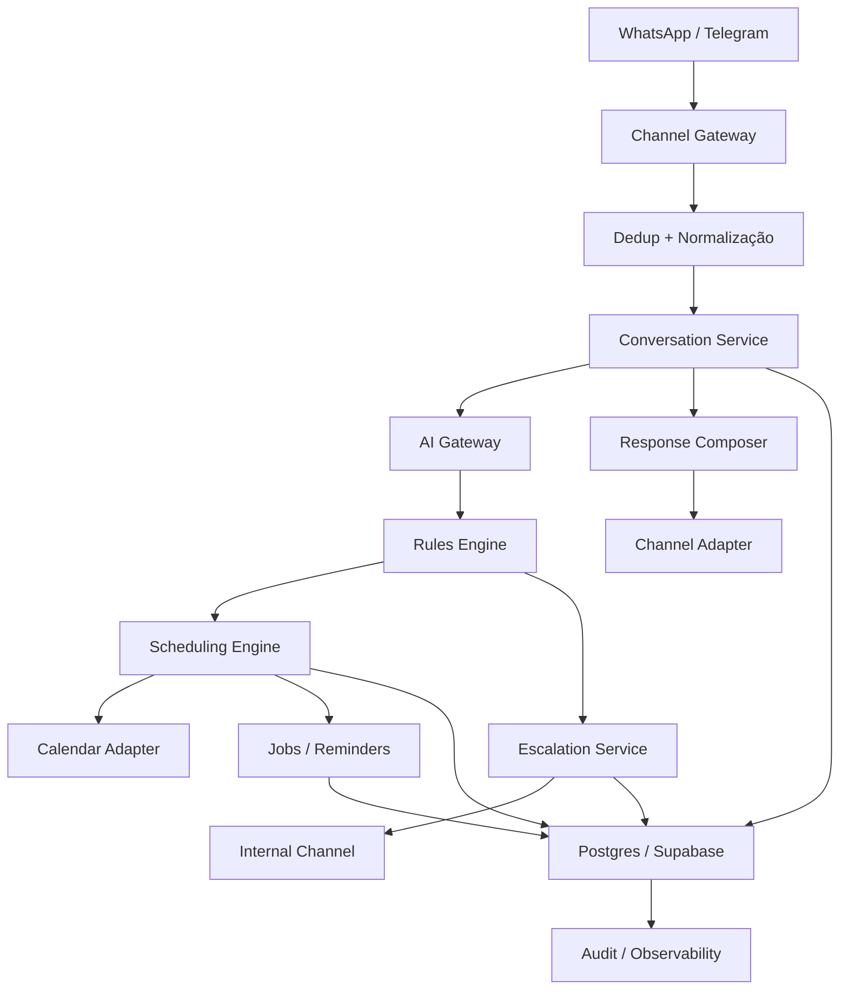
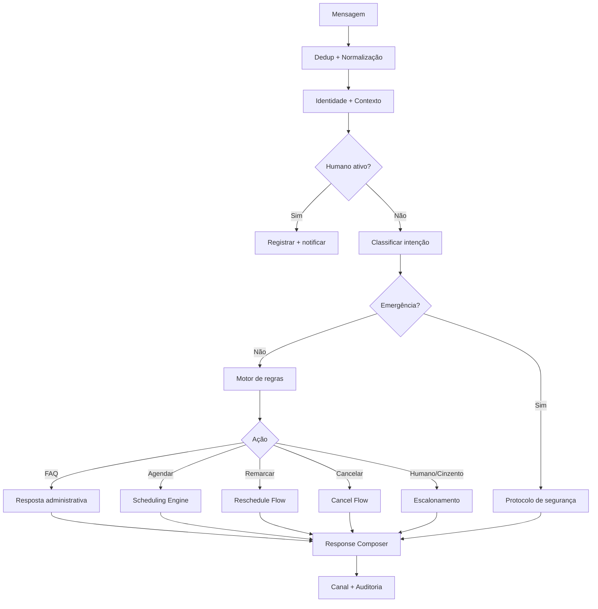

# DOCUMENTO 00 — MVP BLUEPRINT — DENTAL ASSISTANT

**Produto:** Dental Assistant  
**Versão:** 0.1 — MVP  
**Status:** Desenho aprovado para implementação  
**Substitui:** Documentos 01, 02 e 03 naquilo que conflitar  
**Caso inicial:** clínica de dois sócios, sem recepção, WhatsApp business, agenda individual  
**Expansão:** clínicas com recepcionista, múltiplas unidades, ERP, recursos e planos  

---

## Sumário executivo

O Dental Assistant será uma **secretária administrativa virtual** para clínicas odontológicas, começando por uma clínica de dois sócios que não tem recepção. Ela responde no WhatsApp business da clínica, informa o que é administrativo, coleta documentos, agenda, remarca, cancela, confirma, lembra e encaminha para o dentista apenas quando necessário.

A fronteira do produto é **administrativo vs. clínico**, com uma terceira categoria obrigatória: **triagem de segurança**. O bot não diagnostica, não prescreve, não interpreta exames e não decide conduta. Quando a dúvida é clínica, ele não inventa: coleta o que falta, oferece avaliação como próximo passo e registra a pergunta para o dentista.

O MVP é um **vertical slice**: uma conversa entra, o bot responde uma dúvida administrativa, agenda numa agenda real, confirma e registra. Tudo o que não for necessário para provar esse ciclo fica fora — RAG, prontuário, pagamentos, ERP, campanhas, painel completo, multi-tenant operacional.

A arquitetura nasce **multi-tenant por schema e por contrato**, mas a operação do MVP é de uma clínica. Isso evita overfitting e permite evoluir para clínicas com recepcionista, múltiplas unidades, ERP e recursos sem reescrever o núcleo.

**Decisão técnica central:** o caminho crítico é código (TypeScript/NestJS + PostgreSQL/Supabase + worker), não n8n. n8n pode ser usado como automação de back-office, nunca como cérebro transacional do produto.

---

# 1. Decisão de produto e posicionamento

## 1.1. O que o produto é

Uma secretária administrativa que:

- atende no WhatsApp business da clínica;
- responde dúvidas administrativas com informação aprovada;
- coleta dados, documentos e exames necessários;
- consulta disponibilidade e agenda, remarca e cancela;
- confirma presença e envia lembretes;
- organiza a agenda de mais de um profissional, inclusive procedimentos conjuntos;
- encaminha para o dentista somente o que é clínico, excepcional ou cinzento;
- registra tudo para auditoria e melhoria.

## 1.2. O que o produto não é

- não é prontuário odontológico;
- não é sistema de gestão financeira;
- não é ERP odontológico;
- não é diagnóstico, prescrição ou interpretação de exame;
- não é um robô se passando pelos dentistas;
- não é um chatbot que executa ações livremente;
- não é um produto de marketing/campanhas no MVP.

## 1.3. A fronteira: três gavetas

Toda solicitação do paciente cai em uma das três gavetas:

| Gaveta | Comportamento | Exemplos |
|---|---|---|
| **Autônomo** | O bot resolve sozinho, com dados aprovados | horário, endereço, formas de pagamento, preço autorizado, preparo, política de cancelamento, agendamento dentro da regra |
| **Sempre escala** | O bot nunca decide; coleta, registra e encaminha | diagnóstico, indicação cirúrgica, urgência clínica, desconto, exceção de política, caso de menor sem responsável |
| **Cinzento** | O bot não sabe; aplica o default seguro | pergunta não prevista, serviço não cadastrado, convênio não configurado, caso ambíguo |

**Default seguro do cinzento:** reconhecer, coletar o que falta, oferecer avaliação como próximo passo administrativo, criar ticket para o dentista e informar um prazo. Nunca silêncio, nunca invenção, nunca promessa clínica.

## 1.4. A terceira categoria: triagem de segurança

O bot não faz aconselhamento clínico, mas não pode ignorar sinais de risco. Se a mensagem indicar possível emergência (dificuldade para respirar/engolir, inchaço importante, trauma, sangramento intenso, febre alta, dor incapacitante), ele:

1. interrompe o fluxo administrativo;
2. aplica o protocolo aprovado pela clínica;
3. orienta busca de atendimento de urgência, incluindo SAMU 192 quando pertinente;
4. registra a ocorrência e notifica o dentista.

Isso não é diagnóstico. É segurança. O protocolo e as mensagens são aprovados pelo responsável técnico da clínica.

## 1.5. Por que esse recorte é comercialmente forte

- O comprador é o usuário: o dentista sócio decide e sente a dor.
- A dor é aguda: paciente chama enquanto ele atende e vai para outra clínica.
- O ROI é fácil de explicar: captura de paciente + organização de agenda + menos interrupção.
- O risco é menor: sem conselho clínico, sem prontuário, sem prescrição.
- O custo é menor: sem RAG, sem modelo caro para tudo, sem UI complexa.
- A expansão é natural: o mesmo núcleo atende clínica com recepcionista, com ERP ou com múltiplas unidades.

---

# 2. ICP e caso inicial

## 2.1. Clínica piloto

- Dois sócios dentistas (piloto: Chow e Caio).
- Sem recepcionista; o custo do funcionário não se paga.
- A clínica não fica aberta 8h/dia; eles atendem também em outras clínicas e hospitais.
- Pacientes particulares falam no WhatsApp pessoal de cada um.
- Agenda individual por profissional.
- Procedimentos conjuntos são combinados informalmente entre os dois.
- Não há taxa de desistência medida, nem baseline de atendimento.
- O WhatsApp é o canal real; o paciente espera horas por resposta.

## 2.2. O que o MVP precisa resolver para eles

1. Um número business da clínica, separado do pessoal, que responde na hora.
2. Respostas administrativas sem depender dos sócios.
3. Agendamento que respeita a disponibilidade real dos dois, inclusive procedimentos conjuntos.
4. Coleta de documentos/exames e orientações de preparo.
5. Escalonamento estruturado para o dentista quando a dúvida é clínica ou cinzenta.
6. Confirmação e lembrete para reduzir falta.
7. Registro e métricas para provar valor.

## 2.3. O que o MVP não precisa resolver (mas precisa não impedir)

- recepcionista com inbox e SLA;
- múltiplas unidades;
- ERP odontológico;
- prontuário;
- pagamento/depósito;
- campanhas de marketing;
- planos e cobrança recorrente;
- aplicativo próprio.

## 2.4. Como o caso inicial não vira uma armadilha

O MVP é uma **configuração** de um motor genérico, não um fork para dois dentistas. As decisões que preservam a expansão:

- `tenant_id` em todas as entidades desde o primeiro dia;
- `clinic_channels` com um canal por clínica, não número global;
- `clinic_users` com papéis (`owner`, `dentist`, `receptionist`, `admin`) mesmo que no MVP só existam owner/dentist;
- `locations` e `resources` no modelo, mesmo que o MVP use uma unidade e uma cadeira;
- `appointment_professionals` como relação muitos-para-muitos;
- adaptadores substituíveis para canal, calendário, IA e notificação;
- feature flags para ligar recepção, múltiplas unidades, ERP, RAG e pagamentos no futuro.

---

# 3. O que muda em relação aos documentos 01, 02 e 03

## 3.1. Tabela de supersessão

| Documento antigo | O que muda no MVP | Motivo |
|---|---|---|
| **01 — PRD** | Posicionamento: de "recepção virtual de clínica" para "secretária administrativa com limite clínico" | O cliente inicial não tem recepção e não quer um robô clínico |
| **01 — PRD** | Handoff: de recepcionista para dentista via canal interno estruturado | Não existe recepcionista no caso inicial |
| **01 — PRD** | Métrica norteadora: de "taxa de resolução automática" para "agendamentos confirmados e no-show reduzido" | É o que a clínica compra |
| **01 — PRD** | Fora do escopo: RAG, relacionamento avançado e painel completo continuam fora | Foco no vertical slice |
| **02 — Arquitetura** | Stack: de n8n como núcleo para código no caminho crítico; n8n opcional | Testabilidade, versionamento, confiabilidade e licença |
| **02 — Arquitetura** | Agenda: de Google Calendar como fonte oficial para agenda própria com `working_hours`; Calendar como adaptador | Free/busy não define disponibilidade permitida |
| **02 — Arquitetura** | Multi-tenancy: mantém `tenant_id`; adia RLS operacional, planos e painel multi-clínica | Evitar complexidade sem validação |
| **02 — Arquitetura** | Modelo: adiciona horários, exceções, recursos, procedimento conjunto, variantes por quantidade, checklist e canal | O modelo antigo não representa o fluxo real |
| **03 — Workflows** | De 16 workflows para 5–6 fluxos verticais | Menos superfície, mais entrega |
| **03 — Workflows** | Sem `Wait` de horas; processamento event-driven por mensagem | Estado no banco, não na execução |
| **03 — Workflows** | Handoff com ticket e canal interno estruturado + fallback seguro | Operação real sem inbox |
| **03 — Workflows** | RAG/pgvector fora do MVP | FAQ estruturada resolve o administrativo |

## 3.2. O que continua válido

Não será reescrito; será referenciado:

- princípios de segurança e separação IA/regra/integração;
- estados de conversa, agendamento e ticket (com ajustes);
- taxonomia de erros e política de retentativas;
- idempotência, `UNKNOWN`, reconciliação;
- LGPD, auditoria, minimização e controle de acesso;
- contratos internos de dados;
- critérios de aceite de concorrência e falha.

## 3.3. Como ler os documentos antigos

Os documentos 01, 02 e 03 passam a ser **referência histórica e catálogo de detalhes**. Em caso de conflito, vale este Documento 00. O que não for citado aqui pode ser reutilizado se não contrariar as decisões acima.

---

# 4. Escopo do MVP

## 4.1. Must have — o vertical slice

1. **Entrada e deduplicação** de mensagens de WhatsApp (produção) e Telegram (teste).
2. **Identidade e contexto**: contato, paciente, conversa, histórico e estado.
3. **FAQ administrativa** com dados estruturados e respostas aprovadas, sem RAG.
4. **Agendamento** com serviço, profissional, duração, disponibilidade, revalidação, trava, evento e confirmação, inclusive **procedimentos conjuntos configurados**.
5. **Remarcação e cancelamento** com confirmação explícita e regra de política.
6. **Escalonamento estruturado** para o dentista, com ticket, resumo, opções e fallback seguro.
7. **Lembretes e confirmação** de presença via template, respeitando a janela do WhatsApp.
8. **Triagem de segurança** para sinais de urgência.
9. **Auditoria, idempotência, `UNKNOWN` e reconciliação**.
10. **Configuração mínima** (o Manual da Secretária) e **métricas de baseline**, incluindo presença e no-show.
11. **Modo sombra escopado** por 2 semanas: aprovação de casos cinzentos/clínicos e amostra de QA, sem bloquear FAQ e agendamento rotineiro.

## 4.2. Should have — se sobrar tempo no MVP

- transcrição de áudio;
- botões e listas interativas no WhatsApp;
- lista de espera para encaixe;
- pesquisa de satisfação pós-consulta;
- painel web mínimo para tickets.

## 4.3. Out of scope — não construir agora

- RAG, pgvector e ingestão de documentos;
- prontuário, anamnese, diagnóstico, prescrição;
- interpretação de exames e radiografias;
- pagamentos, Pix, depósito, notas fiscais;
- integração com ERP odontológico;
- aplicativo para paciente ou dentista;
- painel administrativo completo;
- planos, cobrança e multi-tenant operacional;
- campanhas de marketing e segmentação;
- relatórios financeiros e comissões;
- integração com múltiplos calendários além do Google.

## 4.4. Como o MVP escala para o produto final

O mesmo núcleo atende, por configuração:

| Modo futuro | O que muda | O que não muda |
|---|---|---|
| Clínica com recepcionista | `clinic_users` com papel `receptionist`; inbox; SLA; auto-resume | Ticket, estados, conversa, agendamento |
| Clínica com ERP | `CalendarAdapter` substituído por `ERPAdapter` | Motor de slots, regras, idempotência |
| Múltiplas unidades | `locations`, `resources` e agenda por unidade | Profissional, serviço, agendamento |
| Planos e cobrança | `plans`, `subscriptions`, limites por tenant | `tenant_id` e contadores de uso |
| Marketing | Consentimento, opt-in, templates e campanhas | Canal, mensagens, jobs |
| RAG administrativo | `knowledge_documents` + pgvector | FAQ estruturada continua prevalecendo |
| Pagamento/depósito | `PaymentProvider` e regra de no-show | Agendamento e confirmação |

---

# 5. Princípios e regras de produto

1. **Administrativo antes de clínico.** O bot resolve o que uma secretária resolveria; o resto vai para o dentista.
2. **Nunca silêncio.** Toda mensagem recebe resposta ou confirmação de recebimento com próximo passo.
3. **Nunca invenção.** Sem dado aprovado, o bot não afirma; coleta, encaminha ou oferece avaliação.
4. **A IA interpreta; a regra decide; a integração executa; o sistema verifica.**
5. **Fonte de verdade da disponibilidade é o motor de agenda da clínica**, não o Google Calendar. O Calendar é um espelho/adaptador.
6. **Toda operação crítica é idempotente e verificável.** `UNKNOWN` é estado de primeira classe.
7. **Remarcação não cancela antes de garantir a nova reserva.**
8. **Handoff é estruturado, assíncrono e com fallback seguro.** Não depende de alguém olhando uma tela.
9. **Preço só é informado se a clínica autorizou.** Sem autorização, "o Dr. confirma na avaliação".
10. **Dados de saúde são sensíveis.** Minimização, retenção, acesso e auditoria desde o primeiro dia.
11. **O MVP é uma configuração do motor, não um fork.** Toda decisão precisa caber na expansão.
12. **O Manual da Secretária é o contrato.** O que não está nele não é respondido como fato.

---

# 6. Arquitetura e stack

## 6.1. Decisão de stack

| Camada | Escolha | Motivo |
|---|---|---|
| Linguagem/backend | TypeScript + NestJS | Ecossistema WhatsApp/Google, tipagem, testabilidade, mercado |
| Banco | PostgreSQL (Supabase) | Transações, constraints, RLS futura, Storage, região SP |
| ORM/consultas | Prisma ou Drizzle + SQL para constraints | Produtividade + controle de SQL crítico |
| Worker/jobs | Worker Node + `pg-boss` ou BullMQ/Redis | Jobs, retentativas, leases, lembretes |
| Painel mínimo | Next.js + Supabase Auth | Configuração e tickets sem construir ERP |
| IA | Camada única de provider (OpenAI/Anthropic/Gemini) | Substituível, com structured output |
| Calendário | `CalendarAdapter` + Google Calendar | Troca futura por ERP |
| Canal | `ChannelAdapter` + WhatsApp Cloud API/Telegram | Troca e teste |
| Observabilidade | OpenTelemetry + Sentry + logs estruturados | Rastrear conversa e operação |
| Deploy | Docker + Fly.io/Render/VPS; Supabase Pro | Simplicidade e região |
| n8n | Opcional, apenas back-office | Não é núcleo transacional |

**Por que não n8n no núcleo:** testabilidade, versionamento, code review, rollback, concorrência, credenciais por tenant e licença comercial. Se o cliente exigir n8n, ele entra como camada de automação, não como dono da máquina de estados.

## 6.2. Componentes



## 6.3. Princípios de arquitetura

- **Event-driven por mensagem:** cada mensagem inbound carrega estado do banco, processa e termina. Não há execução aberta esperando o paciente por horas.
- **Contratos explícitos:** entrada normalizada, resultado padrão, erro padrão.
- **Idempotência no banco:** chave única, não `IF` em código.
- **Concorrência no banco:** advisory lock ou constraint de exclusão por profissional/intervalo, com revalidação externa.
- **Adaptadores:** canal, calendário, IA, notificação e pagamento são interfaces.
- **Segredos:** nunca em JSONB; cofre/secret manager e referência.
- **Observabilidade por correlação:** `conversation_id`, `message_id`, `operation_id`, `execution_id`.

## 6.4. Ambientes e implantação

- `local`: Docker Compose, Supabase local ou projeto de dev, Telegram, fake de Calendar.
- `staging`: Supabase de staging, WhatsApp de teste, dados sintéticos.
- `production`: Supabase Pro em `sa-east-1`, WhatsApp Cloud API, backups, alertas.
- CI/CD: GitHub Actions, migrations versionadas, deploy com rollback.
- Feature flags por tenant para ligar/desligar módulos.

## 6.5. Custo estimado do MVP (ordem de grandeza)

| Item | Faixa mensal |
|---|---|
| Supabase Pro | US$ 25–50 |
| Hospedagem backend/worker | US$ 20–80 |
| IA (baixo volume) | US$ 30–200 |
| WhatsApp (templates) | US$ 10–100 |
| Observabilidade | US$ 0–50 |
| **Total** | **US$ 85–480** |

Números a validar com a tabela vigente da Meta e o preço do provedor de IA. O modelo de negócio precisa caber nessa faixa com margem.

---

# 7. Modelo de dados

## 7.1. Convenções

- PK UUID; `timestamptz` em UTC; dinheiro `numeric`; estados controlados.
- `tenant_id` obrigatório em toda entidade de clínica.
- `created_at`, `updated_at`; soft delete com `deleted_at` quando aplicável.
- FKs compostas com `tenant_id` sempre que possível.
- Índices para busca por tenant, telefone, status e janela de tempo.

## 7.2. Entidades do MVP (reuso do Doc 02 + delta)

### Núcleo de tenant e acesso

| Tabela | Papel | Delta em relação ao Doc 02 |
|---|---|---|
| `clinics` | Tenant | mantém; adiciona `status`, `timezone`, `locale` |
| `clinic_channels` | Canal por clínica | **nova**: `channel`, `provider`, `phone_number_id`, `waba_id`, `display_name`, `status`, `credentials_ref` |
| `clinic_users` | Usuários e papéis | **nova no MVP**: `auth_user_id`, `role` (`owner`, `dentist`, `receptionist`, `admin`), `status` |
| `locations` | Unidade/endereço | **nova**: necessária para expansão; MVP com uma |
| `resources` | Cadeira/sala | **nova opcional**: feature flag; MVP com uma cadeira |

### Catálogo e agenda

| Tabela | Papel | Delta |
|---|---|---|
| `professionals` | Dentistas | mantém; adiciona `location_id` |
| `professional_working_hours` | Horário de trabalho | **nova**: weekday, start, end, location_id, valid_from/to |
| `professional_time_off` | Férias/bloqueios | **nova**: start, end, reason |
| `clinic_holidays` | Feriados | **nova**: date, name, location_id |
| `services` | Procedimentos | adiciona `direct_booking_allowed`, `requires_evaluation`, `preparation_instructions`, `required_documents`, `buffer_before`, `buffer_after` |
| `service_variants` | Preço/duração por quantidade | **nova**: `min_quantity`, `max_quantity`, `price`, `duration_minutes` |
| `service_professional_requirements` | Procedimento conjunto | **nova**: `service_id`, `professional_id`, `role`, `required`; define quais serviços exigem mais de um profissional |
| `professional_services` | Habilitação | mantém |
| `appointments` | Compromissos | adiciona `location_id`, `resource_id`, `source`, `created_by`, `cancellation_reason`, `attendance_status` (`PENDING`, `ATTENDED`, `NO_SHOW`, `LATE_CANCELLED`) |
| `appointment_professionals` | Procedimento conjunto | **nova**: muitos-para-muitos com `role` |
| `appointment_operations` | Idempotência e estado | mantém; adiciona `operation_id` e `external_reference` |
| `availability_locks` | Trava temporária | **nova**: `professional_id`, `start_at`, `end_at`, `expires_at`, `operation_id`, `status` |

### Paciente e conversa

| Tabela | Papel | Delta |
|---|---|---|
| `patients` | Cadastro administrativo | mantém; adiciona `is_minor`, `guardian_patient_id` |
| `patient_contacts` | Contatos por canal | adiciona `opt_in_status`, `opt_in_at`, `opt_out_at`, `verified_at` |
| `conversations` | Conversa | mantém; adiciona `state`, `last_inbound_at`, `human_ticket_id` |
| `messages` | Mensagens | adiciona `media_type`, `media_url`, `transcription`, `delivery_status` |
| `webhook_events` | Dedup de eventos | **obrigatória** no MVP |
| `consent_records` | Consentimento/opt-in | **obrigatória** quando houver comunicação proativa |

### Atendimento humano, conhecimento e operação

| Tabela | Papel | Delta |
|---|---|---|
| `human_tickets` | Escalonamento | adiciona `sla_due_at`, `channel`, `question`, `options`, `answer`, `answered_by`, `answered_at` |
| `ticket_events` | Histórico do ticket | **nova**: created/notified/accepted/answered/resolved |
| `knowledge_entries` | FAQ administrativa | **nova**: pergunta, resposta aprovada, categoria, vigência, autor |
| `message_templates` | Templates WhatsApp | **nova**: nome, categoria, idioma, status, corpo, variáveis |
| `automation_jobs` | Jobs | adiciona `next_run_at`, `locked_at`, `locked_by`, `max_attempts` |
| `ai_invocations` | Custo/qualidade | **nova**: modelo, versão do prompt, tokens, custo, latência, confiança |
| `audit_logs` | Auditoria | mantém; append-only por trigger/permissão |

## 7.3. Restrições e índices críticos

```sql
-- Dedup de mensagem por canal e tenant
UNIQUE (tenant_id, channel, external_message_id);

-- Um contato por canal/tenant
UNIQUE (tenant_id, channel, external_user_id);

-- Idempotência de operação
UNIQUE (tenant_id, idempotency_key);

-- Habilitação única
UNIQUE (tenant_id, professional_id, service_id);

-- Sem sobreposição de agenda por profissional
ALTER TABLE appointments
  ADD CONSTRAINT no_overlap
  EXCLUDE USING gist (
    professional_id WITH =,
    tstzrange(start_at, end_at, '[)') WITH &&
  )
  WHERE (status IN ('BOOKED', 'RESCHEDULE_PENDING'));
```

**Atenção:** a constraint de exclusão cobre a agenda interna. O Google Calendar ainda pode receber eventos criados por terceiros; a revalidação externa continua obrigatória.

## 7.4. Isolamento multi-tenant

- Toda query de aplicação filtra `tenant_id`.
- `tenant_id` é derivado do canal (`clinic_channels`), nunca do corpo da mensagem ou da IA.
- RLS será habilitada para clientes administrativos futuros; no MVP, o backend usa role de serviço, então a garantia real é a camada de acesso + testes de isolamento.
- FKs compostas `(tenant_id, id)` são preferidas para impedir associação cruzada.
- Testes automatizados devem tentar acessar dados de outro tenant e falhar.

## 7.5. Retenção e exclusão

- Mensagens: prazo inicial sugerido de 180 dias, configurável; validar com jurídico.
- Áudios/transcrições: prazo menor, se possível; validar.
- Auditoria: prazo maior, conforme obrigação legal; validar.
- Dados clínicos: fora do escopo; não armazenar.
- Exclusão/anonimização: runbook para atender titular; soft delete + purge job.
- Backup: Supabase Pro; definir RPO/RTO com a clínica.

---

# 8. Fluxos verticais

## 8.1. Visão geral



## 8.2. Entrada e deduplicação

**Entrada:** evento bruto do canal.  
**Saída:** evento normalizado com `tenant_id`, `channel`, `external_user_id`, `external_message_id`, `content`, `media`, `received_at`.

Regras:

- verificar assinatura do webhook (WhatsApp `X-Hub-Signature-256`; Telegram secret token);
- inserir em `webhook_events` com unique constraint; se conflito, encerrar;
- normalizar telefone em E.164;
- classificar tipo de mensagem (texto, áudio, imagem, documento, botão);
- registrar antes de processar.

**Critério de aceite:** evento repetido não gera segunda operação nem segunda resposta.

## 8.3. Identidade e contexto

**Sequência:**

1. buscar `clinic_channels` pelo `phone_number_id`/bot;
2. buscar `patient_contacts` por `(tenant_id, channel, external_user_id)`;
3. se não existir, criar conversa e contato provisório;
4. se existir, carregar paciente, conversa ativa e últimas mensagens;
5. verificar `human_tickets` abertos e estado `HUMAN_ACTIVE`;
6. se humano ativo, registrar mensagem e notificar; não responder automaticamente;
7. senão, seguir para classificação.

**Regra:** telefone não é prova de identidade. Para operações sensíveis (cancelar/remarcar consulta de terceiro), exigir confirmação de nome + data de nascimento ou código enviado ao contato.

## 8.4. FAQ administrativa

**Fonte:** `knowledge_entries` + dados estruturados (`clinics`, `services`, `professionals`, `professional_working_hours`, `clinic_holidays`, `knowledge_entries` de política).

**Regras:**

- dado estruturado prevalece sobre texto livre;
- resposta só com informação aprovada e vigente;
- preço só se `price_disclosure_allowed`;
- convênio só se cadastrado; nunca presumir;
- se não houver resposta, aplicar default do cinzento;
- toda resposta termina com próximo passo administrativo quando fizer sentido.

**Critério de aceite:** 100% das respostas administrativas são rastreáveis a uma entrada vigente ou a um dado estruturado.

## 8.5. Agendamento

### Algoritmo de slots

Entradas: `tenant_id`, `service_id`, `quantity`, `professional_id` (ou "qualquer"), `location_id`, janela de datas.

1. Determinar duração:
   - `service_variants` por quantidade, se existir;
   - senão `services.duration_minutes`;
   - procedimento conjunto: `service_professional_requirements` define os profissionais; duração = **maior** duração entre os serviços + buffers, salvo regra da clínica em contrário; agendas são interseccionadas; recurso único por padrão.
2. Para cada dia da janela:
   - obter `professional_working_hours` do profissional no local;
   - remover `professional_time_off`, `clinic_holidays` e horários fora do funcionamento;
   - remover eventos ocupados do calendário interno e do adapter externo;
   - aplicar `buffer_before`/`buffer_after`, antecedência mínima e horizonte máximo;
   - se procedimento conjunto, interseção de todos os profissionais e recurso.
3. Gerar slots com granularidade configurada (ex.: 15/30 min).
4. Ordenar e agrupar por dia; limitar a N opções por mensagem.
5. Apresentar opções com botões/listas quando o canal permitir.

### Confirmação

1. paciente escolhe slot;
2. resumo do agendamento + confirmação explícita;
3. revalidar disponibilidade (interna + externa);
4. adquirir lock atômico por `(professional_id, slot)`;
5. criar `appointment` com status `BOOKING` e `operation_id`;
6. criar evento no Calendar com ID determinístico derivado de `operation_id` e `extendedProperties.private.operation_id`;
7. verificar o evento por GET;
8. persistir `google_event_id`, status `BOOKED`;
9. liberar lock;
10. responder ao paciente com dados corretos;
11. auditar.

### Falhas

- conflito na revalidação: liberar lock, oferecer alternativas;
- timeout na criação: status `UNKNOWN`, job de reconciliação busca evento por `operation_id`;
- evento criado mas persistência falhou: reconciliação adota o evento e corrige o banco;
- duplicidade: unique de idempotência impede segunda criação.

**Critério de aceite:** nenhum agendamento confirmado sem evento verificado; zero dupla reserva nos testes de concorrência.

## 8.6. Remarcação

1. localizar agendamento do paciente (com autorização);
2. consultar política de antecedência;
3. gerar novos slots;
4. paciente escolhe e confirma;
5. criar nova reserva primeiro (status `RESCHEDULE_PENDING`);
6. verificar criação;
7. cancelar/atualizar a antiga somente após a nova garantida;
8. se falhar após criar a nova, compensar (cancelar a nova ou manter a antiga, conforme estado);
9. registrar auditoria e responder.

**Regra crítica:** nunca cancelar a antiga antes de garantir a nova.

## 8.7. Cancelamento

1. localizar agendamento;
2. validar autorização;
3. consultar política (antecedência, taxa, no-show);
4. apresentar resumo e pedir confirmação explícita;
5. criar operação idempotente;
6. cancelar no Calendar;
7. verificar;
8. atualizar status e motivo;
9. responder e auditar.

**Regra:** linguagem ambígua não cancela. "Acho que não vou conseguir" não é cancelamento; o bot pergunta.

## 8.8. Escalonamento humano

### Objetivo

Levar ao dentista apenas o que ele precisa decidir, com o mínimo de esforço cognitivo, e nunca deixar o paciente sem resposta.

### Canais

- **MVP:** mensagens individuais do bot para cada sócio no WhatsApp (sem grupo), com card estruturado e ticket ID; o dentista responde ao bot com o número da opção ou uma frase curta. Isso evita depender da API de grupos (OBA, limite de participantes e ausência de mensagens interativas).
- **Apoio:** inbox web mínimo (Next.js) com lista de tickets, contexto e botão de resposta, usado quando o WhatsApp não for prático.
- **Regra:** o dentista **não responde diretamente ao paciente por outro número**; ele responde ao bot, e o bot compõe a mensagem. Se o dentista quiser assumir a conversa, ele responde "4" (assumir) e o bot pausa; a conversa continua pelo mesmo canal, com o bot como relay, ou pelo inbox.

### Card de escalonamento

```
[TICKET #123] Paciente: Maria (11) 99999-9999
Pedido: extração de 2 dentes com encaminhamento de ortodontista
Dúvida: pode agendar direto ou precisa avaliação?
Opções:
1) Agendar direto (30 min, R$ X)
2) Agendar avaliação (20 min)
3) Pedir mais informação
4) Assumir conversa
Responda com o número.
```

### Regras

- ticket tem `sla_due_at`, calculado dentro do horário de funcionamento configurado; fora do horário, o SLA começa no próximo período útil;
- se o dentista não responder até o SLA, o bot **não agenda sozinho sem confirmação**: envia ao paciente as opções de avaliação e pergunta "posso reservar o primeiro horário disponível?"; se o paciente confirmar, agenda; se não houver slot ou não houver confirmação, mantém o ticket aberto e informa o próximo passo;
- se o dentista responder depois do fallback, o bot aplica a resposta se ainda não houver reserva; se já houver, informa o dentista e pergunta se deve alterar;
- o dentista pode "assumir conversa"; nesse caso, o bot pausa e registra `HUMAN_ACTIVE`;
- ao encerrar, o bot retoma somente com autorização;
- toda resposta do dentista vira registro no ticket e, se for regra nova, entra no Manual da Secretária.

### Critério de aceite

- 100% dos tickets têm motivo, resumo, pergunta e prazo;
- paciente recebe resposta ou fallback dentro do prazo;
- nenhuma resposta automática durante `HUMAN_ACTIVE`.

## 8.9. Lembretes e confirmação

1. job diário/horário busca agendamentos elegíveis;
2. verifica template aprovado e janela de 24h;
3. verifica opt-in e se já enviou;
4. envia template de lembrete com botões (confirmar/remarcar/cancelar);
5. registra `message_id`, status e resposta;
6. classifica resposta e atualiza `confirmation_status`;
7. encaminha remarcação/cancelamento aos fluxos próprios;
8. não interpreta silêncio como confirmação.

**Regras:** fora da janela de 24h, só template aprovado; respeitar horário local; não duplicar; registrar entrega e leitura quando disponível.

## 8.10. Triagem de segurança

1. classificação de risco + regras determinísticas por palavras-chave;
2. se risco evidente, não esperar o dentista;
3. aplicar protocolo aprovado (mensagem + orientação de urgência/SAMU);
4. registrar ocorrência e notificar;
5. impedir que o fluxo administrativo continue como se nada tivesse acontecido.

**Critério de aceite:** casos de teste de emergência nunca recebem resposta administrativa comum.

## 8.11. Reconciliação e `UNKNOWN`

- job periódico busca operações `UNKNOWN` e eventos órfãos;
- consulta o Calendar por `extendedProperties.operation_id`;
- adota o evento se existir; corrige o banco;
- se não existir, marca `FAILED` e permite nova tentativa segura;
- registra tudo em auditoria;
- alerta se o volume de `UNKNOWN` passar do limite.

## 8.12. Presença e no-show

- `appointments.attendance_status` é preenchido no fechamento do dia.
- O fechamento pode ser feito no painel (lista com um toque por consulta) ou por comando no WhatsApp do bot ("fechamento: 3 atendidos, 1 falta").
- `confirmed` significa resposta positiva ao lembrete ou confirmação explícita no agendamento; consulta sem confirmação continua `PENDING` e aparece no fechamento.
- No-show é medido sobre **todas** as consultas agendadas; cancelamento tardio é status separado (`LATE_CANCELLED`) e não conta como no-show.
- Sem esse preenchimento, a métrica norteadora do piloto não existe.

---

# 9. Manual da Secretária e onboarding

## 9.1. O que é

O **Manual da Secretária** é o artefato de configuração da clínica. Ele não é um formulário: é a codificação do conhecimento tácito dos dentistas. É também o dataset de avaliação do bot e o contrato do que ele pode dizer em nome da clínica.

## 9.2. Estrutura do manual

1. **Identidade e tom** — nome da clínica, como o bot se apresenta, formalidade, emojis, assinatura.
2. **Serviços** — nome, descrição, duração, preço, autorização de divulgação, variantes por quantidade, `direct_booking_allowed`, `requires_evaluation`.
3. **Profissionais** — nome, especialidade, serviços habilitados, horários de trabalho, locais, férias.
4. **Políticas** — cancelamento, remarcação, atraso, no-show, formas de pagamento, convênios.
5. **Logística** — endereço, estacionamento, horário, contato, como chegar.
6. **Preparo e documentos** — por serviço: exames, encaminhamento, jejum, acompanhante, documentos.
7. **FAQ administrativa** — perguntas e respostas aprovadas, com vigência.
8. **Regras de escalonamento** — o que é autônomo, o que sempre escala, o que é cinzento e qual o default.
9. **Protocolo de segurança** — sinais de risco, mensagem, quando indicar SAMU, o que não dizer.
10. **Templates** — lembrete, confirmação, remarcação, cancelamento, pós-consulta.

## 9.3. Processo de onboarding (piloto)

1. **Sessão de 90 min** com os sócios: abrir 5 conversas reais e narrar o que fizeram.
2. **Auditoria de ~30 conversas** recentes, sem nomes/telefones: intenção, administrativo vs clínico, tempo de resposta, desfecho.
3. **Preenchimento do manual** pelo fornecedor, validado pelos sócios.
4. **Configuração** de serviços, preços, horários e regras no sistema.
5. **Modo sombra por 2 semanas**: o bot sugere, o dentista aprova; cada aprovação vira regra/teste.
6. **Go-live** com o número business e acompanhamento diário na primeira semana.
7. **Revisão semanal** do manual e da taxa de escalonamento.

## 9.4. Loop de aprendizado

- todo caso cinzento respondido pelo dentista vira uma entrada no manual;
- toda entrada vira um teste automatizado;
- a taxa de escalonamento deve cair ao longo do tempo;
- se não cair, o manual está raso ou o escopo está errado;
- revisão mensal de preços, políticas, serviços e horários.

## 9.5. Dono e versionamento

- **MVP:** o fornecedor faz a configuração inicial e mantém o manual, com aprovação dos sócios; a clínica pode **ver** e editar campos simples (horários, preços autorizados, FAQ) em um painel mínimo.
- **Futuro:** a clínica edita tudo em painel, com versionamento e aprovação.
- Cada versão tem autor, data, vigência e changelog.
- Preço desatualizado é falha grave de confiança; o sistema deve alertar quando um serviço não é revisado há X dias.

## 9.6. Checklist de extração (perguntas para a sessão)

**Serviços e regras**
1. Quais são os 10 procedimentos mais pedidos?
2. Para cada um: duração, preço, o preço pode ser dito?, precisa de avaliação?, pode agendar direto em algum caso?
3. O preço varia por quantidade (dentes, dentes por arcada, implantes)?
4. Quais documentos/exames o paciente precisa levar?
5. Quais orientações de preparo (jejum, acompanhante, medicação)?
6. Quais serviços vocês não fazem e para onde encaminham?

**Agenda**
7. Quais dias/horários cada um atende na clínica?
8. Como vocês bloqueiam férias, hospital e outras clínicas?
9. Procedimentos conjuntos: quais são e quanto tempo levam?
10. Qual o intervalo mínimo entre consultas? Tem limpeza/preparo?
11. Quantas cadeiras/salas existem?
12. Qual a antecedência mínima para agendar, remarcar e cancelar?
13. Qual o horizonte máximo de agendamento?
14. Como tratam encaixe e urgência?

**Políticas e comunicação**
15. Formas de pagamento? Pix, cartão, parcelamento?
16. Convênios: quais aceitam? Como confirmar?
17. Política de falta e atraso?
18. Quem responde quando o bot escala? Em quanto tempo?
19. O que o bot nunca pode dizer?
20. Quais sinais fazem vocês pararem tudo e orientarem urgência?

**Tom e marca**
21. Como o bot deve se apresentar?
22. Formal ou informal? Emojis?
23. Qual o nome do número business e quem é o titular?

---

# 10. WhatsApp, LGPD e segurança

## 10.1. WhatsApp Cloud API

### Número e WABA

- cada clínica tem seu próprio número business e sua WABA;
- o número pessoal do dentista não é o número do bot;
- recomendação MVP: novo número business + resposta automática no pessoal ("para agendar, chame este número") + atualização de site, Instagram, Google e cartão;
- validar titularidade (clínica/CNPJ) e migração futura.

### Regras operacionais

- **janela de 24h:** mensagens de serviço dentro da janela; fora dela, apenas templates aprovados;
- **templates:** cadastro, categoria (utility/marketing), idioma, aprovação e variáveis;
- **opt-in:** registrar consentimento e origem; opt-out por palavra-chave;
- **qualidade:** monitorar rating, limites e bloqueios;
- **mídia:** áudio (transcrever), imagem/PDF (armazenar e anexar ao agendamento, sem interpretar);
- **interatividade:** botões/listas para reduzir ambiguidade;
- **grupos:** a API de grupos do WhatsApp é restrita (OBA, limite de participantes, sem mensagens interativas); o MVP usa mensagens individuais para os sócios, não grupo;
- **E2EE:** a Cloud API não é ponta a ponta; o conteúdo passa pela Meta. Isso entra no RIPD e no contrato;
- **coexistência:** app + API no mesmo número é limitado; não tratar como garantido.

### Webhook

- validar `X-Hub-Signature-256`;
- responder 200 rápido e processar assíncrono;
- idempotência por `external_message_id`;
- tratar reentrega e eventos fora de ordem.

## 10.2. LGPD

### Papéis

- **Clínica:** controladora dos dados de pacientes.
- **Plataforma:** operadora, tratando conforme instruções e contrato.
- **Suboperadores:** Supabase, Meta, provedor de IA, hospedagem.

### Obrigatório antes de produção

- contrato de tratamento (DPA) com a clínica e suboperadores;
- base legal por finalidade (execução de contrato, legítimo interesse, consentimento para marketing);
- política de privacidade e aviso ao paciente;
- RIPD/DPIA por causa de dados de saúde + IA;
- retenção e descarte definidos;
- processo de direitos do titular (exportar, corrigir, excluir);
- encarregado/DPO e canal de contato;
- resposta a incidentes e registro;
- transferência internacional (região SP; IA pode ser exterior; cláusulas contratuais);
- controle de acesso, MFA, menor privilégio;
- criptografia em repouso/trânsito; campo sensível com proteção adicional;
- logs sem PII desnecessária;
- se usar n8n, desabilitar/prunar execuções com payload.

### Dados de saúde

- o bot não deve solicitar detalhes clínicos além do necessário para o administrativo;
- áudios e imagens podem conter dados sensíveis; tratar com cuidado;
- não usar conteúdo de paciente para treinar modelo;
- provedor de IA com retenção mínima e sem treinamento;
- minimizar/redigir PII antes de enviar ao modelo, quando possível.

## 10.3. Segurança de aplicação

- autenticação do painel com Supabase Auth + MFA;
- RBAC por papel; service role só no servidor;
- validação de entrada e schema;
- rate limiting por contato, tenant e IP;
- proteção contra prompt injection: conteúdo é dado, não instrução; ferramentas em allowlist; autorização fora do LLM;
- segredos em secret manager; rotação; nunca em JSONB ou log;
- auditoria append-only;
- backups e teste de restore;
- alertas para falha de integração, `UNKNOWN`, pico de escalonamento e erro de envio.

---

# 11. Métricas, piloto e critérios de decisão

## 11.1. Baseline (antes do bot)

Coletar 2 semanas de:

- mensagens recebidas por dia;
- tempo até a primeira resposta;
- conversas que viraram agendamento;
- conversas que morreram sem resposta;
- no-show;
- principais intenções e objeções.

Se não houver histórico, usar o log manual e a sessão de onboarding. Sem baseline, não há como provar ROI.

## 11.2. Métricas do produto

| Métrica | Definição | Meta inicial |
|---|---|---|
| Tempo de primeira resposta | do inbound ao primeiro outbound do bot | < 1 min |
| Resolução administrativa | conversas resolvidas sem humano | ≥ 50% |
| Conversão em agendamento | conversas que terminam em consulta | medida contra baseline |
| No-show | faltas / todas as consultas agendadas (não só confirmadas) | reduzir vs baseline |
| Escalonamento | tickets / conversas | começar alto e cair |
| Tempo de aceite humano | ticket criado → resposta do dentista | < 15 min no horário comercial |
| Erros de agenda | conflitos/duplicidades | 0 |
| `UNKNOWN` | operações incertas | < 1% |
| Custo por conversa | IA + WhatsApp + infra | dentro do preço |
| Satisfação | pesquisa simples pós-consulta | ≥ 4/5 |

## 11.3. Desenho do piloto

- 1 clínica, 4 semanas, 2 em modo sombra e 2 em produção.
- Número business ativo; WhatsApp Cloud API.
- Revisão diária na primeira semana; semanal depois.
- Critérios de aceite técnicos e de negócio ao final.

## 11.4. Critérios de sucesso

- o bot responde 100% das mensagens em < 1 min;
- ≥ 50% das dúvidas administrativas resolvidas sem humano;
- agendamentos sem conflito e sem dupla reserva;
- handoff aceito em < 15 min no horário comercial;
- custo por conversa cabe no preço;
- pelo menos uma clínica diz que pagaria pelo produto;
- redução mensurável de tempo de resposta e de conversas perdidas.

## 11.5. Critérios de kill (mudar ou parar)

- a clínica não adota o número business e os pacientes continuam no pessoal;
- a agenda real não está no calendário e não há migração viável;
- áudio é a maioria e a transcrição não funciona;
- o custo por conversa supera o preço aceitável;
- o handoff é operacionalmente inviável;
- após 4 semanas, não há melhora mensurável em resposta, agendamento ou no-show.

---

# 12. Plano de implementação

## Fase 0 — Fundação (1 semana)

- repositório, CI, lint, testes;
- Supabase (dev), migrations, seed;
- schema do MVP, constraints, índices;
- autenticação e papéis;
- observabilidade básica e correlação;
- contratos de entrada/saída.

**DoD:** migrations aplicam do zero; testes de schema e isolamento passam; health check e logs funcionam.

## Fase 1 — Entrada, contexto e FAQ (1–2 semanas)

- adaptador Telegram;
- webhook, dedup, normalização;
- identidade, conversa, mensagens;
- classificação de intenção;
- FAQ administrativa estruturada;
- compositor de resposta;
- testes de ambiguidade e prompt injection.

**DoD:** conversa de teste responde dúvidas administrativas com dados aprovados e não inventa.

## Fase 2 — Agenda e Calendar (2 semanas)

- `working_hours`, `time_off`, `holidays`, `resources`;
- `service_professional_requirements` e procedimentos conjuntos;
- motor de slots;
- `CalendarAdapter` + fake;
- Google Calendar real;
- agendamento, remarcação, cancelamento;
- locks, idempotência, `UNKNOWN`, reconciliação;
- testes de concorrência e timeout.

**DoD:** ciclo completo de agendamento com zero dupla reserva nos testes; reconciliação funciona.

## Fase 3 — Escalonamento, lembretes e segurança (1–2 semanas)

- tickets, card estruturado, mensagens individuais aos sócios + inbox web mínimo;
- SLA e fallback;
- templates e lembretes;
- triagem de segurança;
- jobs e retentativas.

**DoD:** ticket chega ao dentista, resposta é aplicada, fallback funciona; emergência nunca vira resposta administrativa.

## Fase 4 — WhatsApp Cloud API (1 semana)

- WABA, número, verificação;
- webhook com assinatura;
- envio, templates, mídia, botões;
- opt-in/opt-out;
- testes de janela de 24h e reentrega.

**DoD:** conversa real de ponta a ponta no número de teste; template aprovado; mídia tratada.

## Fase 5 — Configuração, manual e métricas (1–2 semanas)

- painel mínimo: agenda (leitura), serviços/preços/horários, FAQ, tickets, métricas, fechamento de presença e aprovação do modo sombra;
- importação/edição do Manual da Secretária;
- dashboard de métricas;
- exportação de auditoria.

**DoD:** clínica consegue ver e ajustar o manual; métricas batem com os eventos.

## Fase 6 — Piloto e hardening (1–2 semanas)

- testes de carga e falha;
- revisão de segurança e LGPD;
- runbooks (incidente, restore, reconciliação);
- treinamento dos sócios;
- go-live assistido.

**DoD:** checklist de produção completo; critérios de aceite do piloto acordados.

**Prazo realista:** 8–12 semanas com dedicação consistente, dependendo de credenciais, verificação Meta e disponibilidade dos sócios para validar conteúdo.

---

# 13. Riscos e mitigação

| Risco | Impacto | Mitigação |
|---|---|---|
| Meta/WhatsApp: verificação, templates, banimento | Alto | Começar cedo, usar template utility, opt-in, monitorar qualidade, número dedicado |
| Número pessoal vs. business | Alto | Número novo + redirect; comunicar pacientes; medir adoção |
| Google Calendar não é a agenda real | Alto | Validar no onboarding; adaptador de ERP no roadmap; não hardcodar |
| Falha de agenda / dupla reserva | Alto | Locks, idempotência, revalidação, reconciliação, testes |
| Alucinação em resposta administrativa | Alto | Dados estruturados prevalecem; resposta rastreável; eval; sem RAG no MVP |
| Custo de IA/WhatsApp | Médio | Modelo menor para classificação; cache; limites; medir custo por conversa |
| LGPD / dados de saúde | Alto | DPA, RIPD, retenção, minimização, região SP, jurídico |
| Adoção pelos sócios | Alto | Modo sombra, canal interno leve, onboarding assistido, ROI visível |
| Escopo crescer | Alto | Vertical slice, feature flags, critérios de kill |
| Dependência de duas pessoas ocupadas | Médio | Sessões curtas, aprovação assíncrona, manual versionado |
| n8n como núcleo | Médio | Não usar no caminho crítico; se usar, isolar e validar licença |
| Sem baseline | Médio | Log manual + auditoria de 30 conversas antes do go-live |

---

# 14. Decisões pendentes

## 14.1. Bloqueiam o início

| ID | Decisão | Dono | Prazo |
|---|---|---|---|
| MVP-D01 | Titularidade e número business (quem é o dono, qual número) | Sócios | Antes da Fase 4 |
| MVP-D02 | Tabela de serviços, preços, durações e autorização de divulgação | Sócios | Antes da Fase 2 |
| MVP-D03 | Regra de agendamento direto vs. avaliação por serviço | Sócios | Antes da Fase 2 |
| MVP-D04 | Horários de trabalho, férias e bloqueios dos dois | Sócios | Antes da Fase 2 |
| MVP-D05 | Canal interno de escalonamento e SLA | Sócios | Antes da Fase 3 |
| MVP-D06 | Provedor de IA e política de retenção | Fornecedor + jurídico | Antes da Fase 1 |
| MVP-D07 | Papéis LGPD, DPA e RIPD | Jurídico | Antes do go-live |
| MVP-D08 | Política de retenção e descarte | Jurídico + sócios | Antes do go-live |
| MVP-D09 | Agenda real hoje (Google, papel ou ERP) e se os sócios vão editar direto nela | Sócios | Antes da Fase 2; default: agenda interna é a fonte de verdade e o Google é adaptador |

## 14.2. Não bloqueiam o MVP

- painel completo;
- RAG/pgvector;
- ERP;
- pagamentos/depósito;
- lista de espera;
- campanhas;
- múltiplas unidades;
- planos e cobrança.

---

# 15. Como este MVP escala para o produto final

## 15.1. O que já nasce pronto

- `tenant_id` e `clinic_channels`;
- `clinic_users` com papéis;
- `locations` e `resources`;
- `appointment_professionals`;
- adaptadores de canal, calendário, IA e notificação;
- feature flags;
- auditoria, idempotência e observabilidade;
- Manual da Secretária versionado.

## 15.2. O que será adicionado sem reescrever o núcleo

| Evolução | Adição |
|---|---|
| Recepcionista | inbox, assignee, SLA, auto-resume, notificações |
| ERP | `ERPAdapter` e mapeamento de agenda/paciente |
| Múltiplas unidades | `locations`, agenda por local, recursos |
| Planos | `plans`, `subscriptions`, limites e medição de uso |
| Marketing | consentimento, templates, campanhas, segmentação |
| RAG | `knowledge_documents`, chunks, embeddings, avaliação |
| Pagamentos | `PaymentProvider`, depósito, no-show fee |
| Prontuário | modelo clínico separado, acesso rigoroso, auditoria de leitura |

## 15.3. O que nunca deve ser feito por conveniência

- colocar regra de clínica em prompt;
- confiar em `tenant_id` vindo do paciente ou da IA;
- executar operação crítica sem idempotência;
- cancelar antes de garantir a nova reserva;
- responder clinicamente sem protocolo aprovado;
- guardar dado clínico no RAG administrativo;
- usar log de execução como auditoria;
- deixar preço/política sem vigência e revisão.

---

# 16. Anexos

## A. Contrato de mensagem normalizada

```json
{
  "tenant_id": "uuid",
  "channel": "whatsapp",
  "external_user_id": "5511999999999",
  "external_conversation_id": "5511999999999",
  "external_message_id": "wamid.xxx",
  "message_type": "text",
  "content": "Quero marcar uma avaliação",
  "media": null,
  "received_at": "2026-11-05T14:00:00Z"
}
```

## B. Contrato de resultado

```json
{
  "success": true,
  "status": "COMPLETED",
  "data": {},
  "error": null,
  "correlation_id": "uuid"
}
```

Estados: `COMPLETED`, `PENDING`, `FAILED`, `UNKNOWN`, `REQUIRES_HUMAN`, `REQUIRES_CLARIFICATION`.

## C. Matriz de decisão (exemplos)

| Mensagem | Gaveta | Ação |
|---|---|---|
| "Qual o horário de vocês?" | Autônomo | Responde dado estruturado |
| "Quanto custa a limpeza?" | Autônomo se preço autorizado | Informa ou "a partir de"; se não autorizado, avaliação |
| "Quero marcar limpeza" | Autônomo se regra permitir | Agenda direto; senão avaliação |
| "Estou com dor no dente" | Sempre escala | Avaliação/urgência; não diagnostica |
| "Preciso arrancar 2 dentes, tenho encaminhamento" | Cinzento | Coleta documento; pergunta ao dentista; fallback avaliação |
| "Vocês aceitam Unimed?" | Autônomo se cadastrado | Informa; se não, escala |
| "Pode fazer desconto?" | Sempre escala | Não negocia; encaminha |
| "Quero cancelar" | Autônomo com confirmação | Confirma identidade e política |
| "Meu filho de 8 anos precisa de avaliação" | Cinzento | Fluxo de responsável legal |
| "Meu rosto inchou e não consigo respirar" | Segurança | Protocolo de urgência/SAMU |

## D. Referências aos documentos antigos

- **Doc 01:** princípios, estados, RNs, LGPD, critérios de aceite.
- **Doc 02:** tabelas, convenções, RLS, concorrência, contratos, observabilidade.
- **Doc 03:** taxonomia de erros, retentativas, segurança de workflows, testes.

Em conflito, vale este Documento 00.

## E. Definição de pronto do MVP

- ciclo conversa → resposta administrativa → agendamento → confirmação funciona de ponta a ponta;
- zero dupla reserva nos testes de concorrência;
- `UNKNOWN` reconciliado;
- handoff com fallback dentro do SLA;
- emergência nunca vira resposta administrativa;
- LGPD operacional revisada;
- métricas de baseline e pós-bot disponíveis;
- manual versionado e validado pelos sócios;
- runbooks de incidente e restore;
- uma clínica piloto usando por 4 semanas.

---

# 17. Registro de decisões do builder check

Um engenheiro independente revisou este documento antes da entrega. As sete lacunas levantadas foram resolvidas assim:

| # | Pergunta do revisor | Decisão |
|---|---|---|
| 1 | Qual é o calendário real e o Google é espelho ou coeditado? | Agenda interna é a fonte de verdade; Google é adaptador opcional; eventos existentes são importados no onboarding; reconciliação por polling; se os sócios editarem direto no Google, a reconciliação detecta. Confirmar a ferramenta real antes da Fase 2 (MVP-D09). |
| 2 | Qual canal interno de escalonamento? | Mensagens individuais do bot para cada sócio, sem grupo; inbox web como apoio; dentista responde ao bot e o bot compõe a resposta; "assumir" é a opção 4. |
| 3 | Quais superfícies humanas e quem configura? | Painel mínimo com agenda (leitura), serviços/preços/horários, FAQ, tickets, métricas, fechamento de presença e aprovação do modo sombra; fornecedor faz a configuração inicial, clínica edita campos simples. |
| 4 | O que acontece quando o SLA vence? | O bot não agenda sozinho sem confirmação; oferece opções de avaliação e pergunta se pode reservar; se não houver confirmação ou slot, mantém o ticket e informa o próximo passo; resposta tardia do dentista é aplicada se ainda não houver reserva. |
| 5 | O modo sombra é obrigatório e o que aprova? | Obrigatório no piloto, mas escopado: casos cinzentos/clínicos e amostra de QA; não bloqueia FAQ nem agendamento rotineiro. |
| 6 | Procedimentos conjuntos entram no MVP? | Sim. `service_professional_requirements` define os pares; duração = maior duração + buffers; interseção de agendas; um recurso por padrão; autônomo se configurado, senão escala. |
| 7 | Como capturar presença e no-show? | `attendance_status` por consulta; fechamento diário no painel ou por comando no WhatsApp; no-show sobre todas as consultas agendadas; cancelamento tardio é status separado. |

A única dependência de campo que permanece é a **MVP-D09** (qual é a agenda real hoje). Ela não bloqueia o código, porque o desenho suporta agenda interna, Google ou, no futuro, ERP.

---

**Fim do Documento 00 — MVP Blueprint.**
