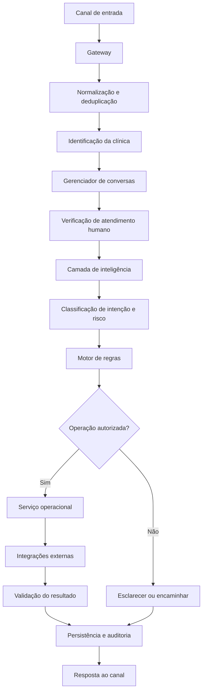
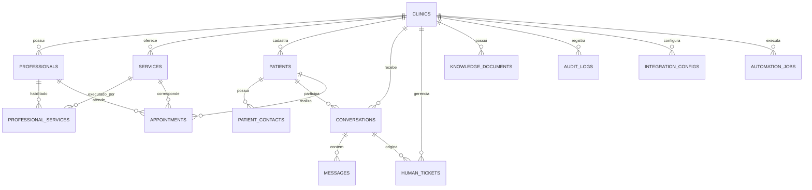

# DOCUMENTO 02 — ARQUITETURA E MODELO DE DADOS
**Produto:** Dental Assistant  
**Versão:** 1.0  
**Status:** Arquitetura proposta para o MVP  
**Banco de dados:** Supabase / PostgreSQL  
**Orquestração:** n8n  
**Agenda:** Google Calendar  
**Canais:** n8n Chat → Telegram → WhatsApp Cloud API  

---

# 1. Objetivo da arquitetura

Definir a estrutura técnica necessária para implementar o Dental Assistant, incluindo:

- Componentes e responsabilidades.
- Comunicação entre os componentes.
- Modelo de dados.
- Relacionamentos.
- Isolamento entre clínicas.
- Gerenciamento de conversas.
- Controle de operações.
- Integrações externas.
- Segurança.
- Tratamento de falhas.
- Diretrizes de escalabilidade.

A arquitetura deverá atender ao MVP sem criar dependências que dificultem a evolução para uma plataforma SaaS.

# 2. Princípios arquiteturais

## 2.1. Separação de responsabilidades

Cada componente deverá possuir uma responsabilidade delimitada.

O n8n será responsável pela orquestração dos processos.

O Supabase será responsável pela persistência, integridade e controle de acesso aos dados.

O Google Calendar será a fonte oficial de disponibilidade e compromissos no MVP.

O modelo de IA será responsável pela interpretação de mensagens e geração de respostas, sem autoridade direta sobre regras críticas.

## 2.2. Arquitetura multitenant desde o início

Mesmo começando com uma clínica, a estrutura deverá possuir isolamento por `tenant_id`.

Toda entidade pertencente a uma clínica deverá estar associada a ela.

A aplicação deverá validar o tenant em todas as operações.

Não será permitido confiar exclusivamente em um `tenant_id` enviado pelo canal ou pelo modelo de IA.

A associação entre canal, credencial e clínica deverá ser determinada por configuração confiável do sistema.

## 2.3. IA desacoplada

O provedor de IA deverá ser substituível.

A aplicação não poderá depender de recursos exclusivos de um único modelo para executar regras fundamentais.

## 2.4. Operações críticas determinísticas

A IA não deverá executar diretamente operações como:

- Criar agendamentos.
- Cancelar consultas.
- Alterar compromissos.
- Modificar cadastros.
- Liberar acesso a informações restritas.

Essas operações deverão passar por validações determinísticas.

## 2.5. Persistência antes da resposta

Operações importantes deverão ser registradas antes de o sistema informar que foram concluídas.

Uma resposta enviada ao paciente não será considerada prova de que a operação foi executada.

---

# 3. Arquitetura geral

## 3.1. Componentes

**1. Gateway de mensagens**

Recebe eventos dos canais externos e os transforma em um formato interno padronizado.

**2. Gerenciador de conversas**

Identifica o paciente, recupera o contexto, verifica o estado da conversa e controla sua continuidade.

**3. Camada de inteligência**

Interpreta a mensagem, identifica intenções, extrai dados e consulta a base de conhecimento.

**4. Motor de regras**

Valida permissões, políticas, parâmetros e condições de execução.

**5. Serviços operacionais**

Executam as operações de cadastro, agenda, relacionamento e atendimento humano.

**6. Camada de integrações**

Gerencia comunicação com Google Calendar, provedores de IA e canais.

**7. Persistência**

Armazena clínicas, pacientes, conversas, mensagens, agendamentos, configurações e auditoria.

**8. Monitoramento**

Registra falhas, operações pendentes, tentativas, métricas e eventos importantes.

## 3.2. Fluxo arquitetural



## 3.3. Regra de comunicação

Os componentes deverão trocar dados por contratos padronizados.

Um workflow não deverá depender de informações implícitas ou posições específicas de nós de outro workflow.

Cada operação deverá possuir entrada e saída documentadas.

---

# 4. Stack tecnológica

| Componente | Tecnologia | Responsabilidade |
|---|---|---|
| Orquestração | n8n Community | Workflows e integrações |
| Banco de dados | Supabase PostgreSQL | Persistência |
| Controle de acesso | Supabase RLS | Isolamento de dados |
| Armazenamento | Supabase Storage | Documentos |
| Agenda | Google Calendar API | Compromissos |
| IA | Provedor intercambiável | Interpretação e respostas |
| Embeddings | Modelo intercambiável | Busca semântica |
| Canal inicial | n8n Chat | Desenvolvimento |
| Canal de testes | Telegram | Testes externos |
| Canal de produção | WhatsApp Cloud API | Atendimento |

A escolha definitiva do provedor de IA dependerá dos testes de qualidade, custo, latência e disponibilidade.

---

# 5. Modelo de dados

## 5.1. Convenções

Todas as tabelas deverão seguir convenções consistentes.

- Chaves primárias: UUID.
- Datas: `timestamptz`, armazenadas em UTC.
- Identificadores externos: texto.
- Valores monetários: `numeric`, nunca ponto flutuante.
- Estados: valores controlados por enumerações ou restrições.
- Datas de criação e atualização: `created_at` e `updated_at`.
- Dados de clínicas: associação obrigatória com `tenant_id`, quando aplicável.

Os horários apresentados ao paciente deverão ser convertidos para o fuso configurado pela clínica.

Fuso padrão inicial: `America/Sao_Paulo`, sujeito à configuração da clínica.

## 5.2. Diagrama de entidades



---

# 6. Especificação das tabelas

## 6.1. clinics

Representa cada clínica cadastrada na plataforma.

| Campo | Tipo | Descrição |
|---|---|---|
| id | UUID | Identificador |
| name | TEXT | Nome da clínica |
| slug | TEXT | Identificador amigável |
| legal_name | TEXT | Razão social |
| tax_id | TEXT | CNPJ, quando necessário |
| phone | TEXT | Telefone |
| email | TEXT | E-mail |
| address | JSONB | Endereço |
| timezone | TEXT | Fuso horário |
| status | TEXT | Situação |
| created_at | TIMESTAMPTZ | Criação |
| updated_at | TIMESTAMPTZ | Atualização |

**Regras:**
- `id` será a referência principal de tenant.
- `slug` deverá ser único.
- Clínicas desativadas não poderão iniciar novos atendimentos automatizados.
- Dados cadastrais deverão possuir validação apropriada.

## 6.2. professionals

Representa dentistas e profissionais vinculados à clínica.

| Campo | Tipo | Descrição |
|---|---|---|
| id | UUID | Identificador |
| tenant_id | UUID | Clínica |
| name | TEXT | Nome |
| registration_number | TEXT | Registro profissional |
| specialty | TEXT | Especialidade |
| calendar_id | TEXT | Agenda Google |
| active | BOOLEAN | Ativo |
| created_at | TIMESTAMPTZ | Criação |
| updated_at | TIMESTAMPTZ | Atualização |

**Regras:**
- Um profissional pertence a uma clínica no MVP.
- Cada profissional poderá possuir uma agenda própria.
- O registro profissional deverá ser armazenado quando necessário e autorizado.
- Não presumir que todo profissional atende todos os serviços.

## 6.3. services

Representa os procedimentos e serviços oferecidos.

| Campo | Tipo | Descrição |
|---|---|---|
| id | UUID | Identificador |
| tenant_id | UUID | Clínica |
| name | TEXT | Nome |
| description | TEXT | Descrição |
| duration_minutes | INTEGER | Duração |
| price | NUMERIC | Valor |
| price_disclosure_allowed | BOOLEAN | Permite divulgar valor |
| category | TEXT | Categoria |
| active | BOOLEAN | Ativo |
| created_at | TIMESTAMPTZ | Criação |
| updated_at | TIMESTAMPTZ | Atualização |

**Regras:**
- Duração deverá ser maior que zero.
- Valores poderão ser nulos quando não definidos.
- A divulgação de valores deverá respeitar configuração da clínica.
- Não confundir preço cadastrado com orçamento ou indicação clínica.

## 6.4. professional_services

Tabela associativa entre profissionais e serviços.

| Campo | Tipo | Descrição |
|---|---|---|
| id | UUID | Identificador |
| tenant_id | UUID | Clínica |
| professional_id | UUID | Profissional |
| service_id | UUID | Serviço |
| active | BOOLEAN | Habilitação ativa |

**Restrição:**
- Combinação `professional_id + service_id` deverá ser única dentro do tenant.

## 6.5. patients

Cadastro administrativo dos pacientes.

| Campo | Tipo | Descrição |
|---|---|---|
| id | UUID | Identificador |
| tenant_id | UUID | Clínica |
| full_name | TEXT | Nome completo |
| birth_date | DATE | Nascimento |
| email | TEXT | E-mail |
| status | TEXT | Situação |
| created_at | TIMESTAMPTZ | Criação |
| updated_at | TIMESTAMPTZ | Atualização |

**Regras:**
- Não utilizar telefone como chave primária.
- O cadastro poderá possuir vários contatos.
- Não armazenar informações clínicas no MVP.
- Não permitir associação automática de responsáveis sem validação.

## 6.6. patient_contacts

Permite associar diferentes contatos a um paciente.

| Campo | Tipo | Descrição |
|---|---|---|
| id | UUID | Identificador |
| tenant_id | UUID | Clínica |
| patient_id | UUID | Paciente |
| channel | TEXT | Canal |
| external_user_id | TEXT | ID externo |
| phone | TEXT | Telefone |
| email | TEXT | E-mail |
| is_primary | BOOLEAN | Principal |
| verified_at | TIMESTAMPTZ | Validação |
| created_at | TIMESTAMPTZ | Criação |

**Regras:**
- Identificadores externos deverão ser únicos por canal e escopo apropriado.
- Contatos compartilhados deverão ser permitidos.
- Um contato não deverá ser considerado automaticamente prova de identidade.
- A validação deverá registrar data e método.

## 6.7. conversations

Representa cada conversa entre paciente e assistente.

| Campo | Tipo | Descrição |
|---|---|---|
| id | UUID | Identificador |
| tenant_id | UUID | Clínica |
| patient_id | UUID | Paciente, se identificado |
| channel | TEXT | Canal |
| external_conversation_id | TEXT | ID externo |
| status | TEXT | Estado |
| current_intent | TEXT | Intenção atual |
| assigned_to | UUID | Responsável humano |
| context_data | JSONB | Contexto operacional |
| last_message_at | TIMESTAMPTZ | Última mensagem |
| created_at | TIMESTAMPTZ | Criação |
| updated_at | TIMESTAMPTZ | Atualização |

**Regras:**
- Uma conversa pertence a uma clínica.
- O paciente poderá ser associado posteriormente.
- O contexto deverá conter somente informações necessárias ao fluxo.
- Dados críticos não deverão existir exclusivamente em JSONB.
- Conversas sob responsabilidade humana não poderão receber respostas automáticas.

## 6.8. messages

Registra as mensagens recebidas e enviadas.

| Campo | Tipo | Descrição |
|---|---|---|
| id | UUID | Identificador |
| tenant_id | UUID | Clínica |
| conversation_id | UUID | Conversa |
| external_message_id | TEXT | ID do canal |
| direction | TEXT | INBOUND / OUTBOUND |
| message_type | TEXT | Tipo |
| content | TEXT | Conteúdo |
| status | TEXT | Situação |
| metadata | JSONB | Metadados |
| created_at | TIMESTAMPTZ | Criação |

**Regras:**
- Mensagens recebidas e enviadas deverão ser diferenciadas.
- O identificador externo deverá ser utilizado na deduplicação.
- Metadados não deverão conter credenciais.
- Conteúdo deverá obedecer à política de retenção da clínica.

## 6.9. appointments

Representa os compromissos administrativos.

| Campo | Tipo | Descrição |
|---|---|---|
| id | UUID | Identificador |
| tenant_id | UUID | Clínica |
| patient_id | UUID | Paciente |
| professional_id | UUID | Profissional |
| service_id | UUID | Serviço |
| google_event_id | TEXT | Evento externo |
| start_at | TIMESTAMPTZ | Início |
| end_at | TIMESTAMPTZ | Término |
| status | TEXT | Estado |
| confirmation_status | TEXT | Confirmação |
| notes | TEXT | Observações administrativas |
| created_at | TIMESTAMPTZ | Criação |
| updated_at | TIMESTAMPTZ | Atualização |

**Regras:**
- A duração deverá corresponder à configuração aprovada.
- O evento deverá estar associado à agenda correta.
- `google_event_id` deverá ser armazenado após confirmação da criação.
- Alterações externas deverão ser reconciliadas.
- Não guardar diagnóstico ou evolução clínica em `notes`.

## 6.10. appointment_operations

Registra cada tentativa de operação relacionada a agendamentos.

| Campo | Tipo | Descrição |
|---|---|---|
| id | UUID | Identificador |
| tenant_id | UUID | Clínica |
| appointment_id | UUID | Agendamento |
| operation_type | TEXT | BOOK / RESCHEDULE / CANCEL |
| idempotency_key | TEXT | Chave única |
| status | TEXT | Estado |
| request_data | JSONB | Solicitação |
| result_data | JSONB | Resultado |
| error_message | TEXT | Erro |
| started_at | TIMESTAMPTZ | Início |
| completed_at | TIMESTAMPTZ | Conclusão |

**Regras:**
- Toda operação crítica deverá ser rastreável.
- A chave de idempotência deverá impedir execução duplicada.
- Operações incertas deverão permanecer identificadas.
- A operação deverá ser verificada antes de repetição.

## 6.11. human_tickets

Gerencia os encaminhamentos para atendimento humano.

| Campo | Tipo | Descrição |
|---|---|---|
| id | UUID | Identificador |
| tenant_id | UUID | Clínica |
| conversation_id | UUID | Conversa |
| patient_id | UUID | Paciente |
| assigned_to | UUID | Atendente |
| reason | TEXT | Motivo |
| priority | TEXT | Prioridade |
| status | TEXT | Estado |
| summary | TEXT | Resumo |
| created_at | TIMESTAMPTZ | Criação |
| accepted_at | TIMESTAMPTZ | Aceite |
| resolved_at | TIMESTAMPTZ | Resolução |

**Regras:**
- Uma pendência deverá possuir motivo.
- O aceite deverá ser registrado.
- O encerramento deverá possuir resultado.
- A conversa deverá permanecer protegida contra respostas automáticas durante o atendimento humano.

## 6.12. knowledge_documents

Gerencia documentos utilizados na base de conhecimento administrativa.

| Campo | Tipo | Descrição |
|---|---|---|
| id | UUID | Identificador |
| tenant_id | UUID | Clínica |
| title | TEXT | Título |
| description | TEXT | Descrição |
| storage_path | TEXT | Caminho no Storage |
| document_type | TEXT | Tipo |
| version | INTEGER | Versão |
| status | TEXT | Estado |
| approved_by | UUID | Responsável pela aprovação |
| approved_at | TIMESTAMPTZ | Aprovação |
| created_at | TIMESTAMPTZ | Criação |

**Regras:**
- Somente documentos aprovados poderão alimentar respostas automáticas.
- Documentos substituídos deverão ser desativados.
- A origem e a versão deverão ser rastreáveis.
- Documentos clínicos não deverão ser incorporados ao RAG do MVP.

## 6.13. integration_configs

Armazena configurações de integrações por clínica.

| Campo | Tipo | Descrição |
|---|---|---|
| id | UUID | Identificador |
| tenant_id | UUID | Clínica |
| provider | TEXT | Provedor |
| config | JSONB | Configurações não secretas |
| credential_reference | TEXT | Referência da credencial |
| status | TEXT | Situação |
| created_at | TIMESTAMPTZ | Criação |
| updated_at | TIMESTAMPTZ | Atualização |

**Importante:** tokens, senhas e chaves privadas não deverão ser armazenados em JSONB. Deverão ficar em armazenamento de credenciais apropriado, com referência segura no banco.

## 6.14. automation_jobs

Registra tarefas programadas e operações assíncronas.

| Campo | Tipo | Descrição |
|---|---|---|
| id | UUID | Identificador |
| tenant_id | UUID | Clínica |
| job_type | TEXT | Tipo |
| payload | JSONB | Dados |
| status | TEXT | Estado |
| attempts | INTEGER | Tentativas |
| scheduled_at | TIMESTAMPTZ | Agendamento |
| executed_at | TIMESTAMPTZ | Execução |
| last_error | TEXT | Último erro |
| created_at | TIMESTAMPTZ | Criação |

Exemplos:
- Lembretes.
- Confirmações.
- Recuperação de operações.
- Notificações.
- Rotinas de reconciliação.

## 6.15. audit_logs

Registra ações importantes.

| Campo | Tipo | Descrição |
|---|---|---|
| id | UUID | Identificador |
| tenant_id | UUID | Clínica |
| actor_type | TEXT | SYSTEM / USER / AI |
| actor_id | UUID | Responsável |
| action | TEXT | Ação |
| entity_type | TEXT | Entidade |
| entity_id | UUID | Registro |
| metadata | JSONB | Metadados |
| created_at | TIMESTAMPTZ | Data |

**Regras:**
- Registros deverão ser protegidos contra alterações indevidas.
- Não registrar credenciais ou conteúdo sensível desnecessário.
- Operações críticas deverão possuir trilha de auditoria.

---

# 7. Tabelas complementares recomendadas

As seguintes tabelas não são opcionais do ponto de vista de uma arquitetura robusta, embora algumas possam ser implementadas em etapas posteriores.

## 7.1. webhook_events

Controla eventos recebidos dos canais.

Campos principais:
- id
- tenant_id
- channel
- external_event_id
- event_type
- payload_hash
- status
- received_at
- processed_at
- error_message

Objetivo: impedir processamento duplicado e permitir rastreamento de eventos.

## 7.2. tenant_settings

Armazena parâmetros operacionais da clínica.

Exemplos:
- Horário de funcionamento.
- Intervalo mínimo de agendamento.
- Antecedência mínima para cancelamento.
- Regras de lembrete.
- Mensagens institucionais.
- Configurações de atendimento.
- Preferências de encaminhamento.

Objetivo: evitar regras de negócio espalhadas pelos workflows.

## 7.3. clinic_users

Relaciona usuários administrativos às clínicas.

Campos:
- id
- tenant_id
- auth_user_id
- role
- status
- created_at

Objetivo: controlar administradores, recepcionistas e outros usuários da clínica.

## 7.4. consent_records

Registra manifestações e autorizações relevantes.

Campos:
- id
- tenant_id
- patient_id
- purpose
- legal_basis
- status
- source
- recorded_at
- revoked_at
- metadata

A tabela deverá ser desenhada de forma a permitir registrar finalidade, origem e contexto da manifestação. Consentimento não deverá ser utilizado como justificativa genérica para todo tratamento de dados.

---

# 8. Relacionamentos e integridade

## 8.1. Chaves estrangeiras

As tabelas deverão possuir chaves estrangeiras para preservar integridade.

Exemplo:

- `appointments.patient_id` → `patients.id`
- `appointments.professional_id` → `professionals.id`
- `appointments.service_id` → `services.id`
- `messages.conversation_id` → `conversations.id`
- `human_tickets.conversation_id` → `conversations.id`

Além da existência da referência, deverá ser validado que os registros pertencem ao mesmo tenant.

Apenas criar chaves estrangeiras individuais não garante isolamento entre clínicas.

## 8.2. Integridade multitenant

Sempre que possível, utilizar chaves únicas compostas e referências compostas envolvendo `tenant_id`.

Exemplo conceitual:

`UNIQUE (tenant_id, id)`

A tabela dependente poderá referenciar:

`FOREIGN KEY (tenant_id, patient_id) REFERENCES patients (tenant_id, id)`

Isso reduz o risco de associação acidental de registros de clínicas diferentes.

## 8.3. Exclusão de registros

Não utilizar exclusão física indiscriminada.

Para dados operacionais, considerar:
- Status de inativação.
- Arquivamento.
- Política de retenção.
- Exclusão quando juridicamente aplicável.
- Preservação de registros necessários à auditoria.

A estratégia deverá respeitar as obrigações legais e os direitos dos titulares.

---

# 9. Segurança e controle de acesso

## 9.1. Row Level Security (RLS)

O Supabase deverá utilizar RLS nas tabelas que contenham dados de clínicas.

A política deverá verificar a associação do usuário autenticado à clínica.

O acesso não poderá depender de um `tenant_id` fornecido livremente pelo cliente.

## 9.2. Perfis de acesso

| Perfil | Permissões |
|---|---|
| Platform Admin | Administração global controlada |
| Clinic Admin | Configurações da própria clínica |
| Receptionist | Atendimento e operações administrativas autorizadas |
| Professional | Acesso futuro conforme necessidade |
| Service Role | Operações internas restritas |

O papel Service Role não deverá ser exposto ao navegador ou a canais públicos.

## 9.3. Segurança dos workflows

- Credenciais devem utilizar o gerenciador de credenciais do n8n.
- Webhooks deverão validar a origem e a autenticidade quando suportado.
- Entradas deverão ser validadas.
- Mensagens externas deverão ser tratadas como dados não confiáveis.
- Prompts não poderão substituir regras de autorização.
- Operações sensíveis deverão passar pelo motor de regras.
- Dados pessoais não deverão ser enviados a modelos sem necessidade e autorização adequadas.

## 9.4. Proteção contra prompt injection

O sistema deverá considerar mensagens e documentos como conteúdo não confiável.

A IA não poderá:
- Alterar regras internas.
- Ignorar políticas de segurança.
- Revelar dados de outras pessoas.
- Executar instruções encontradas em documentos.
- Acessar credenciais.
- Alterar o tenant da conversa.
- Executar ferramentas fora das permissões definidas.

A autorização deverá ocorrer fora do modelo de linguagem.

---

# 10. Contratos internos de dados

Os workflows deverão utilizar estruturas padronizadas.

## 10.1. Evento de entrada normalizado

Exemplo conceitual:

```json
{
  "tenant_id": "uuid",
  "channel": "telegram",
  "external_user_id": "123456",
  "external_conversation_id": "123456",
  "external_message_id": "message_001",
  "message_type": "text",
  "content": "Quero marcar uma avaliação",
  "timestamp": "2026-11-04T18:00:00Z"
}
```

O `tenant_id` deverá ser obtido de configuração confiável do canal, não diretamente da mensagem do usuário.

## 10.2. Resultado da classificação de intenção

```json
{
  "intent": "BOOK_APPOINTMENT",
  "confidence": 0.94,
  "entities": {
    "service": "Avaliação",
    "professional": null,
    "preferred_date": null,
    "preferred_time": null
  },
  "requires_clarification": false,
  "risk_level": "LOW"
}
```

Os valores de confiança serão indicadores auxiliares. Não substituem validações determinísticas.

## 10.3. Solicitação de agendamento

```json
{
  "tenant_id": "uuid",
  "patient_id": "uuid",
  "service_id": "uuid",
  "professional_id": "uuid",
  "start_at": "2026-11-10T14:00:00Z",
  "end_at": "2026-11-10T14:30:00Z",
  "idempotency_key": "booking_unique_key",
  "confirmation_received": true
}
```

Antes da execução, o sistema deverá validar:
- Existência do paciente.
- Existência do serviço.
- Habilitação do profissional.
- Duração.
- Disponibilidade.
- Autorização.
- Confirmação.
- Ausência de operação duplicada.

## 10.4. Resposta de operação

```json
{
  "success": true,
  "operation_id": "uuid",
  "status": "BOOKED",
  "external_reference": "google_event_id",
  "message": "Agendamento registrado"
}
```

Uma resposta de sucesso só poderá ser emitida depois da verificação do resultado real da integração.

---

# 11. Arquitetura de agendamento e concorrência

## 11.1. Problema

Duas pessoas podem consultar o mesmo horário e selecioná-lo simultaneamente.

O Google Calendar não deve ser tratado como mecanismo de reserva transacional exclusiva.

## 11.2. Estratégia

1. Consultar disponibilidade.
2. Apresentar opções.
3. Receber escolha.
4. Validar novamente a disponibilidade.
5. Criar uma operação interna com chave de idempotência.
6. Aplicar controle de concorrência por profissional e intervalo.
7. Tentar criar o evento.
8. Consultar o resultado.
9. Registrar o compromisso.
10. Confirmar ao paciente.

## 11.3. Bloqueios temporários

A arquitetura poderá utilizar uma tabela de bloqueios temporários.

Campos:
- id
- tenant_id
- professional_id
- start_at
- end_at
- expires_at
- operation_id
- status

Os bloqueios deverão expirar automaticamente.

A operação de criação do bloqueio e verificação de conflito deverá ser atômica no banco, por meio de função PostgreSQL.

Uma estratégia de exclusão de intervalos com índices GiST poderá impedir sobreposição de reservas internas.

Entretanto, bloqueios internos não impedem que terceiros criem eventos diretamente no Google Calendar. Por isso, a revalidação externa continuará obrigatória.

## 11.4. Resultado incerto

Se ocorrer timeout durante a criação:

- Não repetir imediatamente.
- Consultar a agenda.
- Procurar o evento correspondente.
- Verificar identificador e parâmetros.
- Atualizar a operação para BOOKED ou FAILED.
- Manter UNKNOWN enquanto não houver confirmação.

Essa regra evita duplicidade de consultas.

---

# 12. Arquitetura de integrações

## 12.1. Google Calendar

Cada profissional poderá possuir uma agenda própria.

O sistema deverá armazenar:
- Identificador da agenda.
- Identificador do evento.
- Data e horário.
- Profissional.
- Serviço.
- Estado interno.

A agenda será a fonte oficial do compromisso.

O Supabase manterá a referência e o histórico operacional.

Deverá existir rotina de reconciliação para identificar divergências entre os registros internos e os eventos externos.

## 12.2. Canais de comunicação

Os canais deverão possuir adaptadores independentes.

Responsabilidades:
- Receber mensagens.
- Validar eventos.
- Normalizar payloads.
- Enviar respostas.
- Interpretar status de entrega quando disponível.

A lógica central de atendimento não deverá depender do formato específico de cada canal.

## 12.3. Provedor de IA

A integração deverá possuir uma camada única de comunicação.

Responsabilidades:
- Enviar contexto mínimo necessário.
- Receber classificação.
- Receber extração de dados.
- Gerar respostas.
- Aplicar timeout.
- Tratar falhas.
- Registrar modelo e versão utilizados quando necessário.

---

# 13. Arquitetura de tarefas assíncronas

Tarefas que não precisam ser executadas durante a resposta imediata deverão ser processadas separadamente.

Exemplos:
- Lembretes.
- Confirmações programadas.
- Recuperação de operações incertas.
- Reconciliação da agenda.
- Notificações internas.
- Processamento de documentos.

No MVP, o n8n poderá utilizar workflows agendados e registros em `automation_jobs`.

Na evolução, será possível adotar filas e workers dedicados.

O processamento deverá possuir:
- Controle de tentativas.
- Limite de tentativas.
- Intervalos progressivos.
- Identificação de falhas permanentes.
- Registro de última execução.
- Recuperação manual quando necessário.

---

# 14. Observabilidade e monitoramento

O sistema deverá monitorar:

- Eventos recebidos.
- Mensagens processadas.
- Mensagens duplicadas.
- Tempo de resposta.
- Erros de IA.
- Erros do Google Calendar.
- Falhas de envio.
- Agendamentos criados.
- Agendamentos cancelados.
- Operações incertas.
- Pendências humanas.
- Jobs atrasados.

Os logs deverão permitir rastrear uma operação usando identificadores de correlação.

Não deverão armazenar conteúdo sensível indiscriminadamente.

---

# 15. Estratégia de armazenamento e RAG

## 15.1. Documentos administrativos

Documentos aprovados serão armazenados no Supabase Storage.

Os metadados ficarão em `knowledge_documents`.

O processamento deverá incluir:
1. Upload.
2. Validação.
3. Extração de texto.
4. Divisão em trechos.
5. Geração de embeddings.
6. Armazenamento vetorial.
7. Indexação.
8. Recuperação contextual.
9. Geração de resposta com fonte identificável.

## 15.2. pgvector

O PostgreSQL poderá utilizar pgvector para busca semântica.

A tabela de chunks poderá ser criada em etapa própria, com:
- id
- tenant_id
- document_id
- chunk_index
- content
- embedding
- metadata
- created_at

A busca deverá sempre filtrar pelo tenant correto.

A recuperação de documentos não poderá permitir que informações de uma clínica apareçam em respostas de outra.

## 15.3. Evolução clínica futura

Prontuário odontológico e documentos clínicos deverão possuir arquitetura separada.

Não deverão ser adicionados à tabela de pacientes ou ao RAG administrativo por conveniência.

A evolução exigirá:
- Modelo de dados clínicos próprio.
- Controle de acesso mais rigoroso.
- Auditoria de leitura e alteração.
- Versionamento.
- Autoria profissional.
- Integridade documental.
- Política de retenção.
- Revisão jurídica e de segurança.

---

# 16. Estratégia de escalabilidade

## Fase 1 — Desenvolvimento local

- n8n local.
- Supabase Free.
- Google Calendar.
- Chat do n8n.
- Provedor de IA com limite gratuito ou modelo local.

## Fase 2 — Testes externos

- Telegram Bot.
- Webhook HTTPS.
- Persistência real.
- Monitoramento.
- Testes de concorrência e falhas.

## Fase 3 — Produção de uma clínica

- Infraestrutura com disponibilidade contínua.
- WhatsApp Cloud API.
- Backups.
- Monitoramento.
- Segurança revisada.
- Políticas de retenção.
- Gestão de credenciais.

## Fase 4 — SaaS

- Cadastro de múltiplas clínicas.
- Onboarding.
- Painel administrativo.
- Gestão de planos.
- Gestão de limites.
- Monitoramento central.
- Processamento assíncrono.
- Filas e workers.
- Estratégia de backup e recuperação.
- Política de isolamento e segurança revisada.

A arquitetura inicial deverá evitar dependências de uma única clínica, um único canal ou um único provedor de IA.

---

# 17. Decisões técnicas pendentes

| ID | Decisão | Quando definir |
|---|---|---|
| AT-001 | Modelo de autenticação administrativa | Antes do painel |
| AT-002 | Provedor de IA | Antes do módulo conversacional |
| AT-003 | Estratégia de embeddings | Antes do RAG |
| AT-004 | Política de retenção de mensagens | Antes dos testes com dados reais |
| AT-005 | Estratégia de backup | Antes da produção |
| AT-006 | Estratégia de bloqueio de agenda | Antes do agendamento |
| AT-007 | Estrutura de usuários e permissões | Antes do acesso administrativo |
| AT-008 | Infraestrutura de hospedagem | Antes da produção |
| AT-009 | Estratégia de filas | Antes de escalar |
| AT-010 | Gestão de credenciais por clínica | Antes de multitenancy operacional |
| AT-011 | Estratégia de reconciliação do Calendar | Antes da produção |
| AT-012 | Política de armazenamento de documentos | Antes do RAG |

---

# 18. Critérios de aprovação da arquitetura

A arquitetura estará apta para implementação quando:

1. Todas as entidades principais estiverem definidas.
2. Todas as tabelas possuírem relacionamentos coerentes.
3. O isolamento por clínica estiver implementado e testado.
4. As políticas RLS estiverem validadas.
5. Credenciais estiverem protegidas.
6. Os contratos internos estiverem padronizados.
7. Operações críticas possuírem idempotência.
8. Agendamentos possuírem controle de concorrência.
9. Falhas externas possuírem tratamento definido.
10. Conversas humanas estiverem protegidas contra automação simultânea.
11. A arquitetura permitir substituir canais e provedores de IA.
12. Dados administrativos estiverem separados de dados clínicos.

---

# 19. Diretriz final de implementação

A implementação deverá começar pela estrutura de dados e pelos contratos internos, não pelos prompts da IA.

Ordem recomendada:

1. Criar projeto Supabase.
2. Criar tabelas e relacionamentos.
3. Criar restrições e índices.
4. Implementar RLS.
5. Criar dados de configuração da clínica.
6. Criar gateway e normalização de eventos.
7. Implementar gerenciamento de conversas.
8. Implementar classificação de intenção.
9. Implementar motor de regras.
10. Implementar operações de agenda.
11. Implementar atendimento humano.
12. Implementar relacionamento.
13. Implementar monitoramento e recuperação.

**Princípio central:** o Dental Assistant deverá funcionar como um sistema operacional de atendimento com IA, e não como um chatbot que recebe mensagens e executa ações livremente.

A inteligência artificial será uma camada de interpretação e comunicação. A confiabilidade do produto deverá estar garantida principalmente pela arquitetura, pelas regras de negócio, pela persistência e pelas validações determinísticas.

---

**Fim do Documento 02 — Arquitetura e Modelo de Dados.**