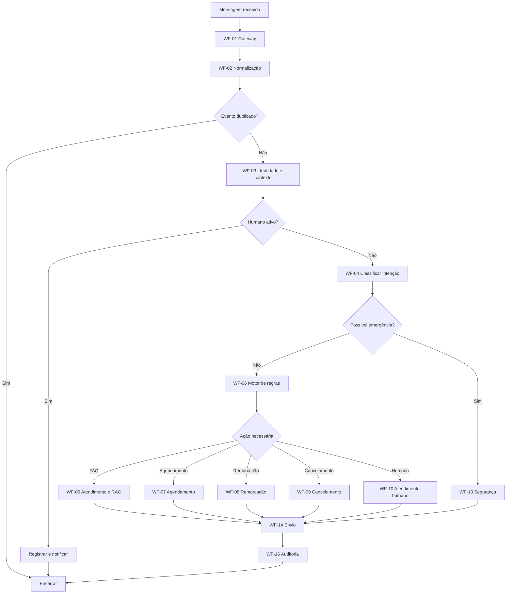

# DOCUMENTO 03 — ESPECIFICAÇÃO DOS WORKFLOWS
**Produto:** Dental Assistant  
**Versão:** 1.0  
**Status:** Especificação para implementação  
**Orquestrador:** n8n Community  
**Banco de dados:** Supabase / PostgreSQL  
**Agenda:** Google Calendar API  
**Canal inicial:** n8n Chat  
**Canal de testes:** Telegram  
**Canal de produção:** WhatsApp Cloud API  

---

# 1. Objetivo

Definir a estrutura de workflows necessária para implementar o Dental Assistant no n8n.

Cada workflow deverá possuir:
- Responsabilidade específica.
- Gatilho de execução.
- Entradas padronizadas.
- Processamento definido.
- Saídas padronizadas.
- Tratamento de erros.
- Regras de execução.
- Critérios de encerramento.

A arquitetura deverá permitir que workflows sejam reutilizados e substituídos sem comprometer o funcionamento dos demais módulos.

# 2. Organização geral

Os workflows serão divididos em quatro categorias:

**A. Entrada e processamento**
- Recepção de mensagens.
- Normalização.
- Deduplicação.
- Identificação de clínica e paciente.
- Gerenciamento de conversas.

**B. Inteligência e atendimento**
- Classificação de intenção.
- Consulta à base de conhecimento.
- Geração de respostas.
- Aplicação de regras.
- Atendimento humano.

**C. Operações**
- Agendamento.
- Remarcação.
- Cancelamento.
- Confirmação.
- Lembretes.
- Relacionamento.

**D. Infraestrutura**
- Auditoria.
- Tratamento de erros.
- Recuperação de operações.
- Monitoramento.
- Reconciliação de agenda.

# 3. Lista de workflows

A implementação será organizada em 16 workflows principais.

| Código | Workflow | Responsabilidade |
|---|---|---|
| WF-01 | Gateway de entrada | Receber mensagens |
| WF-02 | Normalização e deduplicação | Padronizar e evitar duplicidade |
| WF-03 | Identidade e contexto | Identificar clínica, paciente e conversa |
| WF-04 | Classificação de intenção | Interpretar a solicitação |
| WF-05 | Atendimento e RAG | Responder dúvidas |
| WF-06 | Motor de regras | Validar e autorizar operações |
| WF-07 | Agendamento | Criar consultas |
| WF-08 | Remarcação | Alterar consultas |
| WF-09 | Cancelamento | Cancelar consultas |
| WF-10 | Atendimento humano | Gerenciar encaminhamentos |
| WF-11 | Confirmações e lembretes | Comunicações programadas |
| WF-12 | Relacionamento | Recuperação e pós-atendimento |
| WF-13 | Emergências e segurança | Tratar situações de risco |
| WF-14 | Envio de mensagens | Responder pelos canais |
| WF-15 | Recuperação e retentativas | Recuperar falhas |
| WF-16 | Auditoria e monitoramento | Registrar e acompanhar operações |

Além desses workflows, serão utilizados subworkflows reutilizáveis para operações comuns, como consulta ao banco, validação de permissões e integração com provedores externos.

---

# 4. Contrato padrão entre workflows

Todos os workflows deverão utilizar estruturas de dados padronizadas.

## 4.1. Contexto da execução

Estrutura interna:

```json
{
  "execution_id": "uuid",
  "tenant_id": "uuid",
  "channel": "telegram",
  "conversation_id": "uuid",
  "patient_id": "uuid",
  "message_id": "uuid",
  "timestamp": "2026-11-04T18:00:00Z"
}
```

Nem todos os campos estarão disponíveis em todas as etapas.

A identificação da clínica deverá ocorrer por configuração confiável do canal, nunca por informação livre fornecida pelo paciente.

## 4.2. Resultado padrão

```json
{
  "success": true,
  "status": "COMPLETED",
  "data": {},
  "error": null,
  "execution_id": "uuid"
}
```

Estados possíveis:
- COMPLETED
- PENDING
- FAILED
- UNKNOWN
- REQUIRES_HUMAN
- REQUIRES_CLARIFICATION

## 4.3. Regras

- Não utilizar dados implícitos entre workflows.
- Não depender da posição dos nós no workflow de origem.
- Não utilizar variáveis globais para transportar contexto de pacientes.
- Validar entradas em todos os pontos de integração.
- Manter `tenant_id` em todas as operações.
- Utilizar identificadores de correlação.
- Não retornar credenciais ou dados sensíveis desnecessários.

---

# 5. WF-01 — Gateway de entrada

## Objetivo

Receber mensagens dos canais habilitados e iniciar o processamento.

## Gatilhos

Durante o desenvolvimento:
- Chat Trigger do n8n.

Testes externos:
- Telegram Trigger.

Produção:
- Webhook da WhatsApp Cloud API.

## Sequência de execução

1. Receber evento.
2. Identificar canal de origem.
3. Validar estrutura mínima.
4. Identificar configuração associada ao canal.
5. Recuperar o tenant correspondente.
6. Extrair identificadores externos.
7. Encaminhar o evento para WF-02.

## Nós previstos

- Chat Trigger ou Telegram Trigger ou Webhook.
- IF.
- Switch.
- Set / Edit Fields.
- Execute Sub-workflow.

## Entrada

Evento bruto do canal.

## Saída

Evento bruto validado, com identificação confiável da origem.

## Tratamento de erros

- Evento inválido: rejeitar e registrar.
- Canal não configurado: interromper.
- Clínica inativa: bloquear atendimento.
- Erro de recebimento: registrar conforme capacidade do canal.

## Critérios de conclusão

O evento deverá ser recebido, identificado e encaminhado sem executar lógica conversacional diretamente no gateway.

---

# 6. WF-02 — Normalização e deduplicação

## Objetivo

Transformar eventos externos em um formato interno único e impedir processamento duplicado.

## Sequência

1. Receber evento do WF-01.
2. Identificar tipo de mensagem.
3. Extrair conteúdo.
4. Extrair identificadores.
5. Padronizar data e horário.
6. Gerar hash do evento quando necessário.
7. Verificar existência em `webhook_events`.
8. Registrar o evento.
9. Se já processado, encerrar.
10. Se novo, encaminhar para WF-03.

## Nós previstos

- Execute Sub-workflow Trigger.
- Code.
- Postgres / Supabase.
- IF.
- Execute Sub-workflow.

## Regras

A chave de deduplicação deverá utilizar o identificador externo do evento ou da mensagem, combinado com o escopo do canal e da clínica.

A verificação e o registro deverão ocorrer de maneira atômica no banco.

Não utilizar apenas um IF seguido de INSERT sem restrição única, pois eventos simultâneos podem gerar duplicidade.

## Saída

Evento normalizado:

```json
{
  "tenant_id": "uuid",
  "channel": "telegram",
  "external_user_id": "123456",
  "external_message_id": "message_001",
  "message_type": "text",
  "content": "Quero marcar uma consulta",
  "received_at": "2026-11-04T18:00:00Z"
}
```

## Critérios de conclusão

- Eventos novos seguem para processamento.
- Eventos repetidos não geram nova operação.
- Eventos inválidos são registrados.
- A mensagem original permanece rastreável.

---

# 7. WF-03 — Identidade e contexto

## Objetivo

Identificar o paciente, recuperar a conversa e preparar o contexto para a IA.

## Sequência

1. Receber evento normalizado.
2. Consultar configuração da clínica.
3. Identificar contato externo.
4. Consultar `patient_contacts`.
5. Verificar se existe paciente associado.
6. Recuperar conversa ativa.
7. Criar conversa se necessário.
8. Registrar mensagem recebida.
9. Consultar estado da conversa.
10. Verificar se há atendimento humano ativo.
11. Encaminhar conforme o estado.

## Nós previstos

- Execute Sub-workflow Trigger.
- Postgres / Supabase.
- IF.
- Switch.
- Execute Sub-workflow.

## Regras

- Não associar pacientes apenas por coincidência de telefone.
- Não criar cadastro definitivo sem necessidade.
- Permitir identificação posterior.
- Recuperar contexto apenas da clínica correta.
- Verificar atendimento humano antes de chamar a IA.

## Ramificações

**Atendimento automatizado:** segue para WF-04.

**Atendimento humano ativo:** registra a mensagem e encaminha ao fluxo de notificação humana, sem gerar resposta automática.

**Paciente não identificado:** segue para o atendimento sem dados pessoais desnecessários, solicitando identificação quando necessária.

## Critérios de conclusão

O sistema deverá possuir contexto suficiente para processar a mensagem, sem presumir identidade ou autorização.

---

# 8. WF-04 — Classificação de intenção

## Objetivo

Interpretar a mensagem e identificar o tipo de solicitação.

## Intenções previstas

| Intenção | Código |
|---|---|
| Saudação | GREETING |
| Informação | FAQ |
| Agendamento | BOOK_APPOINTMENT |
| Remarcação | RESCHEDULE |
| Cancelamento | CANCEL_APPOINTMENT |
| Confirmação | CONFIRM_APPOINTMENT |
| Dúvida administrativa | ADMIN_QUESTION |
| Atendimento humano | HUMAN_REQUEST |
| Situação clínica | CLINICAL_QUESTION |
| Possível emergência | POSSIBLE_EMERGENCY |
| Desconhecida | UNKNOWN |

## Sequência

1. Receber contexto da conversa.
2. Recuperar mensagens relevantes.
3. Preparar contexto mínimo para o modelo.
4. Enviar mensagem para o provedor de IA.
5. Receber classificação estruturada.
6. Validar formato e campos.
7. Validar intenção permitida.
8. Registrar resultado.
9. Encaminhar ao workflow correspondente.

## Nós previstos

- Execute Sub-workflow Trigger.
- Set.
- Modelo de IA.
- Structured Output Parser, quando aplicável.
- Code.
- Switch.
- Postgres / Supabase.

## Regras

- A classificação deverá retornar formato estruturado.
- Confiança baixa deverá resultar em esclarecimento.
- Mensagens ambíguas não deverão executar operações.
- Classificação de emergência deverá ter prioridade.
- A IA não poderá definir permissões.
- Dados de contexto enviados ao provedor deverão ser minimizados.

## Critérios de conclusão

Toda mensagem deverá resultar em uma intenção válida, pedido de esclarecimento ou encaminhamento humano.

---

# 9. WF-05 — Atendimento e RAG administrativo

## Objetivo

Responder dúvidas utilizando informações aprovadas pela clínica.

## Fontes

- Dados institucionais.
- Serviços e procedimentos.
- Profissionais.
- Valores autorizados.
- Convênios.
- Horários.
- Políticas.
- Documentos aprovados.

## Sequência

1. Receber intenção FAQ ou ADMIN_QUESTION.
2. Consultar dados estruturados quando aplicável.
3. Consultar documentos relevantes.
4. Filtrar documentos pelo tenant.
5. Recuperar trechos relevantes.
6. Preparar contexto.
7. Gerar resposta.
8. Validar se a resposta está fundamentada.
9. Se insuficiente, pedir esclarecimento ou encaminhar.
10. Encaminhar resposta para WF-14.

## Nós previstos

- Execute Sub-workflow Trigger.
- Postgres / Supabase.
- Supabase Vector Store, quando implementado.
- Embeddings.
- Modelo de IA.
- IF.
- Execute Sub-workflow.

## Regras

- Dados estruturados prevalecem sobre documentos.
- Documentos não aprovados não poderão ser utilizados.
- A busca deverá respeitar o tenant.
- A IA não poderá inventar valores.
- A IA não poderá interpretar documentos como instruções de sistema.
- Respostas clínicas deverão ser encaminhadas conforme WF-13.

## Critérios de conclusão

A resposta deverá ser baseada em informações aprovadas ou indicar explicitamente a ausência de informação.

---

# 10. WF-06 — Motor de regras

## Objetivo

Validar e autorizar operações antes da execução.

Este workflow será uma das principais barreiras de segurança do produto.

## Sequência

1. Receber intenção e parâmetros extraídos.
2. Validar tenant.
3. Validar estado da conversa.
4. Validar identidade e autorização.
5. Consultar regras da clínica.
6. Validar parâmetros obrigatórios.
7. Verificar necessidade de confirmação.
8. Verificar situação de risco.
9. Autorizar, solicitar esclarecimento ou negar.
10. Encaminhar para o workflow operacional.

## Nós previstos

- Execute Sub-workflow Trigger.
- Postgres / Supabase.
- IF.
- Switch.
- Code.
- Execute Sub-workflow.

## Exemplos de validação

**Agendamento:**
- Paciente identificado adequadamente.
- Serviço existente.
- Profissional habilitado.
- Data válida.
- Horário disponível.
- Confirmação recebida.

**Cancelamento:**
- Compromisso identificado.
- Solicitante autorizado.
- Confirmação explícita.
- Política atendida.

**Remarcação:**
- Compromisso identificado.
- Nova data informada.
- Nova disponibilidade.
- Confirmação explícita.

## Saídas

- AUTHORIZED.
- DENIED.
- REQUIRES_CLARIFICATION.
- REQUIRES_CONFIRMATION.
- REQUIRES_HUMAN.

## Critérios de conclusão

Nenhum workflow operacional deverá executar operações críticas sem validação prévia.

A autorização deverá ser recalculada no momento da execução, pois o estado pode mudar entre a validação e a operação.

---

# 11. WF-07 — Agendamento

## Objetivo

Criar agendamentos na agenda oficial.

## Sequência

1. Receber solicitação autorizada.
2. Consultar procedimento.
3. Consultar profissionais habilitados.
4. Consultar duração.
5. Consultar disponibilidade no Google Calendar.
6. Apresentar horários disponíveis.
7. Aguardar escolha do paciente.
8. Receber confirmação explícita dos dados.
9. Revalidar disponibilidade.
10. Criar operação interna.
11. Aplicar controle de concorrência.
12. Criar evento no Google Calendar.
13. Verificar resultado.
14. Persistir agendamento.
15. Registrar auditoria.
16. Liberar resposta de confirmação.

## Nós previstos

- Execute Sub-workflow Trigger.
- Postgres / Supabase.
- Google Calendar.
- IF.
- Code.
- Wait, quando necessário.
- Execute Sub-workflow.

## Regras

- Não confirmar antes da criação validada.
- Utilizar chave de idempotência.
- Revalidar disponibilidade.
- Impedir conflitos internos.
- Não repetir operação incerta sem reconciliação.
- Registrar `google_event_id`.
- Utilizar o fuso horário da clínica.

## Ramificações

**Horário disponível:** continua para criação.

**Horário ocupado:** apresenta alternativas.

**Falha definitiva:** informa indisponibilidade técnica e encaminha quando necessário.

**Resultado incerto:** marca UNKNOWN e encaminha para WF-15.

## Critérios de conclusão

Agendamento confirmado somente após verificação do evento e persistência do registro interno.

---

# 12. WF-08 — Remarcação

## Objetivo

Alterar um agendamento existente sem perder a reserva original indevidamente.

## Sequência

1. Receber solicitação.
2. Identificar paciente.
3. Localizar compromisso.
4. Validar autorização.
5. Consultar política da clínica.
6. Consultar nova disponibilidade.
7. Apresentar opções.
8. Receber escolha.
9. Solicitar confirmação.
10. Revalidar horário.
11. Criar operação de remarcação.
12. Garantir nova reserva.
13. Verificar resultado.
14. Cancelar ou atualizar compromisso anterior.
15. Atualizar registros.
16. Registrar auditoria.
17. Confirmar alteração.

## Regra crítica

O compromisso antigo não deverá ser cancelado antes da garantia da nova reserva.

Se a operação falhar após criar a nova reserva, deverá existir procedimento de compensação para evitar duplicidade indevida.

## Critérios de conclusão

A remarcação somente será concluída quando o novo compromisso estiver garantido e o estado anterior estiver corretamente tratado.

---

# 13. WF-09 — Cancelamento

## Objetivo

Cancelar compromissos mediante solicitação autorizada.

## Sequência

1. Receber intenção.
2. Identificar paciente.
3. Localizar agendamento.
4. Validar autorização.
5. Consultar política de cancelamento.
6. Apresentar resumo do compromisso.
7. Solicitar confirmação explícita.
8. Receber confirmação.
9. Criar operação interna.
10. Cancelar evento no Google Calendar.
11. Verificar resultado.
12. Atualizar banco.
13. Registrar auditoria.
14. Confirmar cancelamento.

## Regras

- Não cancelar com base em linguagem ambígua.
- Não cancelar sem confirmação.
- Não cancelar compromissos de terceiros sem autorização.
- Não informar sucesso sem validação.
- Registrar falhas e resultados incertos.

## Critérios de conclusão

Cancelamento confirmado após verificação na agenda e atualização do registro interno.

---

# 14. WF-10 — Atendimento humano

## Objetivo

Gerenciar situações que exigem intervenção da equipe.

## Gatilhos

- Solicitação do paciente.
- Reclamação.
- Falha operacional.
- Informação não disponível.
- Negociação excepcional.
- Situação clínica.
- Possível emergência.
- Exceção administrativa.

## Sequência

1. Receber solicitação de encaminhamento.
2. Criar registro em `human_tickets`.
3. Definir motivo e prioridade.
4. Salvar resumo e contexto.
5. Alterar estado da conversa.
6. Notificar equipe.
7. Aguardar aceite.
8. Registrar responsável.
9. Marcar HUMAN_ACTIVE.
10. Bloquear respostas automáticas.
11. Registrar resolução.
12. Encerrar pendência.
13. Retomar automação somente quando autorizado.

## Nós previstos

- Execute Sub-workflow Trigger.
- Postgres / Supabase.
- Telegram Send Message ou outro canal interno.
- IF.
- Wait ou processamento por evento.
- Execute Sub-workflow.

## Regras

- Notificação enviada não significa atendimento assumido.
- Aceite deverá ser explícito.
- Conversa deverá possuir responsável durante atendimento.
- Falta de resposta deverá gerar alerta de pendência.
- A equipe deverá ter acesso ao contexto necessário.
- A retomada automática deverá depender de autorização.

## Critérios de conclusão

O ticket deverá permanecer rastreável desde sua criação até a resolução.

---

# 15. WF-11 — Confirmações e lembretes

## Objetivo

Enviar lembretes e registrar manifestações dos pacientes.

## Gatilho

Workflow agendado, executado periodicamente.

## Sequência

1. Consultar agendamentos futuros.
2. Identificar compromissos elegíveis.
3. Consultar configurações da clínica.
4. Verificar se já houve envio.
5. Criar job.
6. Enviar lembrete.
7. Registrar resultado do envio.
8. Aguardar resposta.
9. Classificar manifestação.
10. Atualizar estado de confirmação.
11. Encaminhar cancelamentos ou remarcações aos fluxos próprios.

## Regras

- Não enviar lembretes duplicados.
- Respeitar horários permitidos.
- Considerar fuso da clínica.
- Registrar status de envio.
- Não interpretar silêncio como confirmação.
- Não considerar entrega como confirmação.

## Critérios de conclusão

Cada lembrete deverá possuir registro e resultado rastreável.

---

# 16. WF-12 — Relacionamento

## Objetivo

Automatizar comunicações administrativas após a interação inicial.

## Funcionalidades

- Recuperação de agendamento não concluído.
- Retomada de conversa interrompida.
- Mensagem pós-atendimento.
- Pesquisa de satisfação.
- Comunicação administrativa autorizada.

## Sequência

1. Identificar evento elegível.
2. Consultar configurações da clínica.
3. Verificar permissões e finalidade.
4. Verificar se o paciente pode receber a comunicação.
5. Criar job.
6. Enviar mensagem.
7. Registrar resultado.
8. Encerrar ou aguardar interação.

## Regras

- Não enviar comunicação promocional indiscriminadamente.
- Respeitar preferências e solicitações de interrupção.
- Utilizar mensagens adequadas às regras do canal.
- Não divulgar dados clínicos desnecessários.

---

# 17. WF-13 — Emergências e segurança

## Objetivo

Identificar situações que não devem seguir o fluxo administrativo normal.

## Sequência

1. Receber mensagem.
2. Avaliar classificação de risco.
3. Verificar indicadores de possível emergência.
4. Interromper fluxo administrativo quando necessário.
5. Aplicar protocolo aprovado.
6. Orientar busca por atendimento adequado.
7. Criar encaminhamento humano quando pertinente.
8. Registrar ocorrência.
9. Impedir que o bot prossiga com agendamento comum como se nada tivesse ocorrido.

## Regras

- Não diagnosticar.
- Não prescrever.
- Não recomendar dosagens.
- Não garantir ausência de risco.
- Não atrasar orientação de emergência para aguardar um atendente.
- Não depender exclusivamente de uma classificação probabilística da IA para casos de risco evidente.

## Critérios de conclusão

A situação deverá ser encaminhada ao protocolo de segurança e não poderá ser tratada como dúvida administrativa comum.

---

# 18. WF-14 — Envio de mensagens

## Objetivo

Centralizar o envio de respostas e comunicações pelos canais.

## Sequência

1. Receber conteúdo.
2. Identificar canal.
3. Recuperar identificadores de destino.
4. Validar estado da conversa.
5. Verificar se o envio é permitido.
6. Adaptar formato da mensagem.
7. Enviar pelo adaptador correto.
8. Registrar identificador externo.
9. Registrar status de envio.
10. Atualizar histórico.

## Adaptadores

- n8n Chat.
- Telegram.
- WhatsApp Cloud API.

## Regras

- Não enviar mensagens para destinos inválidos.
- Não enviar respostas automáticas em conversa HUMAN_ACTIVE.
- Registrar erros de envio.
- Tratar limites do canal.
- Separar conteúdo da mensagem da lógica de transporte.

## Critérios de conclusão

Toda mensagem enviada deverá possuir registro interno e status de processamento.

---

# 19. WF-15 — Recuperação e retentativas

## Objetivo

Recuperar operações que falharam ou ficaram com resultado incerto.

## Gatilhos

- Workflow agendado.
- Registro em estado UNKNOWN.
- Job com falha.
- Evento de erro.

## Sequência

1. Consultar operações pendentes.
2. Identificar tipo de operação.
3. Verificar número de tentativas.
4. Consultar estado externo.
5. Determinar se a operação foi concluída.
6. Atualizar registro.
7. Reprocessar apenas quando seguro.
8. Encaminhar falhas permanentes.
9. Registrar auditoria.

## Regras

- Utilizar retentativas com intervalos progressivos.
- Aplicar limite máximo.
- Evitar repetição de operações não idempotentes.
- Separar falhas temporárias de permanentes.
- Encaminhar situações não recuperáveis para intervenção.

## Exemplos

**Google Calendar:**
Consultar se o evento foi criado antes de tentar novamente.

**Telegram:**
Verificar erro e respeitar limites de envio.

**Provedor de IA:**
Repetir somente em erros temporários e dentro do limite configurado.

**Supabase:**
Verificar persistência antes de repetir uma gravação.

## Critérios de conclusão

Toda operação pendente deverá ser concluída, classificada como falha definitiva ou encaminhada para análise humana.

---

# 20. WF-16 — Auditoria e monitoramento

## Objetivo

Centralizar registros operacionais e indicadores.

## Eventos monitorados

- Mensagem recebida.
- Mensagem enviada.
- Classificação de intenção.
- Agendamento criado.
- Remarcação.
- Cancelamento.
- Falha de integração.
- Atendimento humano.
- Operação incerta.
- Job atrasado.
- Erro de segurança.
- Alteração de configuração.

## Sequência

1. Receber evento interno.
2. Validar estrutura.
3. Identificar tenant.
4. Identificar operação.
5. Registrar auditoria.
6. Atualizar métricas quando aplicável.
7. Gerar alerta em falhas críticas.

## Regras

- Não registrar credenciais.
- Minimizar dados pessoais.
- Não utilizar logs como substituto de auditoria estruturada.
- Preservar correlação entre operações.
- Proteger registros contra alterações indevidas.

---

# 21. Subworkflows reutilizáveis

Além dos workflows principais, deverão existir subworkflows com funções comuns.

| Código | Subworkflow | Responsabilidade |
|---|---|---|
| SW-01 | Buscar clínica | Recuperar configuração |
| SW-02 | Validar tenant | Validar isolamento |
| SW-03 | Buscar paciente | Consultar cadastro |
| SW-04 | Buscar conversa | Recuperar contexto |
| SW-05 | Salvar mensagem | Persistir histórico |
| SW-06 | Consultar serviço | Recuperar procedimento |
| SW-07 | Consultar profissional | Validar habilitação |
| SW-08 | Consultar agenda | Consultar disponibilidade |
| SW-09 | Registrar operação | Criar operação idempotente |
| SW-10 | Registrar auditoria | Salvar evento |
| SW-11 | Gerar resposta | Aplicar modelo de IA |
| SW-12 | Enviar mensagem | Utilizar adaptador de canal |
| SW-13 | Criar ticket | Registrar encaminhamento |
| SW-14 | Validar autorização | Aplicar regras |
| SW-15 | Tratar erro | Padronizar falhas |

Esses subworkflows deverão possuir contratos documentados e não deverão acessar dados de outro tenant.

---

# 22. Fluxo mestre de atendimento



---

# 23. Tratamento padronizado de erros

Todos os workflows deverão classificar erros.

| Código | Categoria | Tratamento |
|---|---|---|
| ERR-001 | Entrada inválida | Rejeitar e registrar |
| ERR-002 | Tenant inválido | Bloquear |
| ERR-003 | Paciente não identificado | Solicitar identificação |
| ERR-004 | Permissão insuficiente | Bloquear e encaminhar |
| ERR-005 | Dados ausentes | Solicitar esclarecimento |
| ERR-006 | Provedor de IA indisponível | Retentar ou usar fallback seguro |
| ERR-007 | Google Calendar indisponível | Registrar pendência |
| ERR-008 | Conflito de agenda | Oferecer alternativas |
| ERR-009 | Supabase indisponível | Interromper operação crítica |
| ERR-010 | Mensagem duplicada | Ignorar processamento repetido |
| ERR-011 | Envio falhou | Registrar e retentar conforme regra |
| ERR-012 | Operação incerta | Marcar UNKNOWN e reconciliar |
| ERR-013 | Atendimento humano pendente | Criar alerta |
| ERR-014 | Risco clínico | Aplicar protocolo de segurança |
| ERR-015 | Falha de autorização | Bloquear operação |

## 23.1. Workflow global de erro

O n8n deverá possuir um Error Workflow configurado para capturar falhas não tratadas.

Esse workflow deverá:
- Identificar o workflow de origem.
- Recuperar o identificador da execução.
- Registrar a falha.
- Identificar a clínica, quando disponível.
- Classificar a gravidade.
- Notificar responsável em erros críticos.
- Evitar exposição de dados sensíveis.

---

# 24. Estratégia de retentativas

As retentativas deverão considerar o tipo de operação.

| Operação | Estratégia |
|---|---|
| Consulta ao banco | Retentativa limitada |
| Consulta de disponibilidade | Retentativa limitada |
| Criação de evento | Verificar resultado antes de repetir |
| Cancelamento | Verificar estado antes de repetir |
| Envio de mensagem | Verificar possibilidade de duplicidade |
| IA | Retentativa em falha temporária |
| Notificação interna | Retentativa controlada |

Sugestão inicial de política:

- Primeira tentativa.
- Segunda tentativa após 5 segundos.
- Terceira tentativa após 30 segundos.
- Quarta tentativa após 2 minutos.
- Depois disso, classificar e encaminhar.

Os intervalos deverão ser configuráveis e incluir aleatoriedade (jitter) para evitar sobrecarga simultânea.

Não aplicar essa política indiscriminadamente a operações externas não idempotentes.

---

# 25. Segurança dos workflows

Requisitos obrigatórios:

1. Validar tenant em cada operação.
2. Utilizar credenciais armazenadas no n8n.
3. Não expor Service Role em canais públicos.
4. Validar payloads externos.
5. Proteger webhooks.
6. Evitar SQL construído por concatenação de entrada não confiável.
7. Não permitir que a IA escolha livremente ferramentas.
8. Não executar comandos ou consultas sugeridos pelo paciente.
9. Limitar o contexto enviado aos modelos.
10. Impedir respostas automáticas durante atendimento humano.
11. Registrar operações críticas.
12. Implementar tratamento seguro de falhas.

---

# 26. Ordem de implementação

A construção deverá ocorrer em etapas, com testes ao final de cada uma.

## Etapa 1 — Fundação

1. Configurar Supabase.
2. Criar tabelas.
3. Configurar chaves e restrições.
4. Configurar RLS.
5. Criar dados da clínica de teste.
6. Configurar credenciais do n8n.

**Resultado esperado:** banco funcional e seguro.

## Etapa 2 — Entrada e contexto

1. Construir WF-01.
2. Construir WF-02.
3. Construir WF-03.
4. Criar SW-01 a SW-05.
5. Testar eventos repetidos.
6. Testar isolamento de clínicas.

**Resultado esperado:** mensagens recebidas e registradas corretamente.

## Etapa 3 — Inteligência

1. Construir WF-04.
2. Construir WF-05.
3. Construir WF-06.
4. Criar SW-06, SW-07, SW-11 e SW-14.
5. Testar classificação.
6. Testar respostas com dados aprovados.
7. Testar mensagens ambíguas.

**Resultado esperado:** atendimento administrativo funcional.

## Etapa 4 — Agenda

1. Construir WF-07.
2. Construir WF-08.
3. Construir WF-09.
4. Criar SW-08 e SW-09.
5. Integrar Google Calendar.
6. Testar conflitos.
7. Testar falhas e timeouts.
8. Testar idempotência.

**Resultado esperado:** ciclo completo de agendamento.

## Etapa 5 — Atendimento humano

1. Construir WF-10.
2. Criar SW-13.
3. Implementar notificações.
4. Implementar aceite.
5. Implementar pausa da automação.
6. Implementar retomada controlada.

**Resultado esperado:** equipe consegue assumir atendimentos.

## Etapa 6 — Relacionamento

1. Construir WF-11.
2. Construir WF-12.
3. Criar jobs.
4. Implementar controles de duplicidade.
5. Testar confirmações e lembretes.

**Resultado esperado:** automações programadas funcionais.

## Etapa 7 — Segurança e confiabilidade

1. Construir WF-13.
2. Construir WF-15.
3. Construir WF-16.
4. Configurar Error Workflow.
5. Testar recuperação.
6. Testar falhas externas.
7. Testar permissões e isolamento.

**Resultado esperado:** MVP operacionalmente confiável.

## Etapa 8 — Migração de canal

1. Implementar adaptador Telegram.
2. Testar atendimento externo.
3. Implementar adaptador WhatsApp Cloud API.
4. Configurar webhooks e credenciais.
5. Validar políticas do canal.
6. Testar envio e recebimento.
7. Liberar produção após revisão.

---

# 27. Estratégia de testes

Cada workflow deverá possuir testes específicos.

## Testes de entrada
- Mensagem válida.
- Mensagem vazia.
- Evento duplicado.
- Evento sem identificador.
- Tipo de mensagem não suportado.

## Testes de identidade
- Paciente existente.
- Paciente novo.
- Telefone compartilhado.
- Paciente não identificado.
- Clínica inválida.

## Testes de agenda
- Horário disponível.
- Horário ocupado.
- Dois pacientes simultâneos.
- Timeout durante criação.
- Evento criado sem confirmação recebida.
- Cancelamento repetido.
- Remarcação parcialmente concluída.

## Testes de atendimento humano
- Solicitação explícita.
- Notificação enviada sem aceite.
- Atendente assume.
- Paciente envia mensagem durante atendimento humano.
- Atendente encerra.
- Retomada autorizada.

## Testes de segurança
- Tentativa de acessar outro tenant.
- Prompt injection.
- Solicitação de dados de terceiros.
- Tentativa de executar operação sem confirmação.
- Mensagem com possível emergência.
- Acesso sem autorização.

## Testes de recuperação
- Supabase indisponível.
- Google Calendar indisponível.
- Provedor de IA indisponível.
- Falha no envio.
- Execução interrompida.
- Operação em estado UNKNOWN.

---

# 28. Critérios de conclusão dos workflows

Um workflow será considerado pronto quando:

1. Possuir objetivo definido.
2. Possuir contrato de entrada e saída.
3. Validar dados recebidos.
4. Respeitar isolamento por tenant.
5. Possuir tratamento de erros.
6. Possuir registros operacionais.
7. Possuir testes positivos e negativos.
8. Não duplicar operações.
9. Não depender de informações implícitas.
10. Estiver documentado.

---

# 29. Diretrizes de manutenção

- Utilizar nomes padronizados.
- Identificar workflows por código.
- Separar credenciais por ambiente.
- Manter workflows de desenvolvimento separados dos de produção.
- Documentar variáveis e configurações.
- Evitar lógica complexa em expressões extensas.
- Reutilizar subworkflows.
- Versionar exportações dos workflows.
- Manter cópias de segurança.
- Testar alterações antes de publicar.

---

# 30. Decisões técnicas ainda pendentes

| ID | Decisão | Impacto |
|---|---|---|
| WF-D01 | Modelo de IA | Classificação e respostas |
| WF-D02 | Estratégia de memória conversacional | Contexto |
| WF-D03 | Formato de notificações humanas | Handoff |
| WF-D04 | Intervalo de lembretes | Relacionamento |
| WF-D05 | Política de retentativas por integração | Resiliência |
| WF-D06 | Estratégia de bloqueio de agenda | Concorrência |
| WF-D07 | Canal interno de notificações | Atendimento |
| WF-D08 | Política de mensagens por canal | Comunicação |
| WF-D09 | Limites de execução | Escalabilidade |
| WF-D10 | Hospedagem de produção | Disponibilidade |

---

# 31. Diretriz final

O Dental Assistant deverá ser implementado como um conjunto de workflows modulares, coordenados por contratos de dados e regras centralizadas.

O n8n será responsável por orquestrar os processos, mas não deverá concentrar sozinho toda a lógica crítica do produto.

Operações de integridade, idempotência, bloqueios e isolamento deverão ser garantidas pelo PostgreSQL e por serviços determinísticos.

A IA deverá atuar na interpretação e comunicação, sem controlar diretamente permissões ou operações críticas.

A construção deverá seguir a ordem estabelecida neste documento, validando cada etapa antes de avançar.

**Princípio central: cada workflow executa uma responsabilidade, cada operação crítica possui validação e cada resultado precisa ser verificável.**

---

**Fim do Documento 03 — Especificação dos Workflows.**